# 软件设计师

> 配套课程：【【2026软考中级-软件设计师】基础阶段|考点理论精讲【已完结】】 https://www.bilibili.com/video/BV1rc411t71D/?p=6&share_source=copy_web&vd_source=670072b151e9fb277c65473cfa10e116
>
> 部分图片来源网络，如有侵权，请联系删除


## 常数

1. **常用的2的次方：**

| 2¹²  | 2¹¹  | 2¹⁰      | 2⁹   | 2⁸   | 2⁷   | 2⁶   | 2⁵   | 2⁴   | 2³   | 2²   | 2¹   | 2⁰   |
| :--- | :--- | :------- | :--- | :--- | :--- | :--- | :--- | :--- | :--- | :--- | :--- | :--- |
| 4096 | 2048 | **1024** | 512  | 256  | 128  | 64   | 32   | 16   | 8    | 4    | 2    | 1    |

2. 常用单位的数值表达

- 1K = 2^10^
  - 一个十进制数 ÷ 1024 = n（K）,K 为单位
  - 二进制数 ÷ 2^10^  = n (K )
- 1M = 2^20^ = 1024K
- 1G = 2^30^ = 1024 M
- 1t = 2^40^ = 1024 G


3. bit的单位换算

- 1bit (位) x 8 = 1 byte(字节)   ，即 1B = 8b


4. 

# 1. 计算机组成原理

## 1.1计算机基础


## 1.2真值与机器数

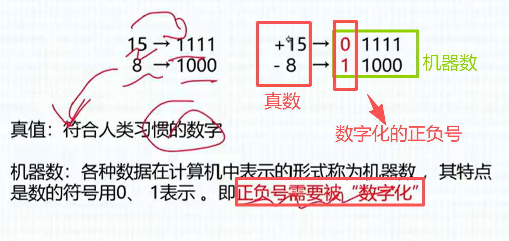

## 1.3 定点数与浮点数

### 1.定点数：

1. 定义：就是**小数点的位置固定**的数。

2. 分类：小数点的位置通常有两种约定方式:

   - 定点整数：纯整数，小数点在最低有效数值位之后

     (注意这里最开头的01依旧表示符号位，不是数值位)

     如：0 0101. 

   - 定点小数：纯小数，小数点在最高有效数值位之后

     如：0 .0101


### 2. 浮点数

1. 定义：浮点数是**小数点位置不固定**的数，它能表示更大范围的数。

   在浮点表示法中，阶码通常为带符号的纯整数，尾数为带符号的纯小数。

2. 浮点数的表示格式图：

   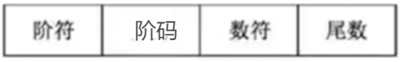

   公式：


$$
   N=M⋅R^E
$$

- **阶码**：决定浮点数所能表示的**数值范围**;
- **尾数**：决定浮点数所能表示的数值精度，尾数越长，所能表示的精度越大，例如0.10001101011


3. 理解学习：浮点数的小数点位置不固定，可以先从十进制的科学计数法开始理解：

- 假设我们有这样三个数： 
  - 3.14 x 10^3^
  - 0.314 x 10^4^
  - 31.4 x 10^2^

​	不难发现，三个数的表现方法不同，但是表示的结果都是：3140 。而这三个的数的**区别**在于：**小数点的位置，指数大小**

- 其中：
  - **尾数（M）：**3.14 （或是0.314等等，注意，在计算机中，尾数一般被规定为**纯小数**）
  - **基数（R)：** 10  (在计算机中一般是2)
  - **指数（R）：**2  (或是3,4等)

​	根据上面的案例，可以得到如下的公式：
$$
N=M⋅R^E
$$


​	其中，N表示所要的数字，例如案例中的 3140	

​	当我们把这个概念放入**二进制**的时候，那就是浮点数

- 来看这张图：它表示了浮点数的表示方式，我们来结合具体案例学习

  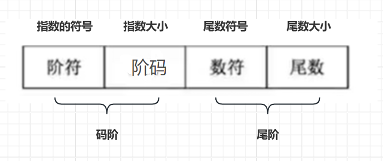

  ​	有这样一个二进制数： 0 1 0 1 1 0 1 0，假设规定阶码尾阶的**二进制位数**各为4（此处仅用于举例，并不准确），那么就可以把它分成两部分：

​		1）**阶码：** **0** 1 0 1 ：

​			0 : **阶符**, 0为正 

​			101: 阶码，表示指数大小 101 = 5d

​		2）**尾阶**： **1** 0 1 0：

​			 1 :（数符：1为负） 

​			010：在尾数中二进制被规定为**纯小数**，所以一个是：0.010，按权展开得到：0 x 2^-1^ + 1 x 2^-2^ + 0 x 2^-1^ = 0.25,

​				   加上刚才判断的**数符**，就是 -0.25

- 在得到了对应的数字之后，就可以把它带入之前的公式，得到：-0.25 x 2^5^ = -8 就这就是该浮点数表示的十进制值

  

## 1.4 校验码

1. 定义：在使用计算机时，通过键盘等设备向cpu等传递信息，数据交换难免出错。为确保数据在传送过程中正确无误

   - 一是提高硬件电路的可靠性
   - 二是提高代码的校验能力。其中就需要用到**校验码，**用来检测传送的数据是否出错。

2. **码距:** 指一个编码系统中，任意两个合法编码之间，至少**有多少个二进制位不同**。

   ​	（即：就是两个合法编码之间，最少有几个数字不一样。）

- 解释：例如有两个编码 `101` 和 `100` ，它们只有最后一位不同，那码距就等于1

### 1.4.1 奇偶校验码

1. **定义：**通过在编码中增加一位**校验位**，来使编码中1的个数为奇数(奇校验)或者为偶数(偶校验),从而**使码距变为2**。

   ​	对于奇校验，它可以检测代码中奇数个出错的编码，但不能发现**偶数个**出错的情况，即当合法编码中奇数位发生了错误，也就是	编码中的1变成0或0变成1,则该编码中1的个数的奇偶性就发生了变化，从而可以发现错误。

   - ==注意==：奇偶校验只能用于**发现错误**，不能用于纠正错误！

2. **详解：**如何更好的理解校验码，可以通过这个案例来学习：

   此案例中使用的是**偶校验**，奇校验的原理相同，不重复说明

- 在计算机中所传输的数据都为二进制，假设我们要传输一个数据为：

   `0011 1001` ，如果传输过程中发生错误，变成 `0011 1101`，与原本正确的数据只相差一个1（有一个0错传成了1），我们很难直接发现错误，此时就可以用到奇偶校验码

- 假设我们使用**偶校验**(要求1的个数总为偶数)，看原始数据：`0011 1001` 有四个1，已经是偶数了，那就在末尾补上一个0作为**校验位**（不影响整体偶数个数）

  如果原始数据1的数量为奇数，则最后的校验位要补一个1，保证1的个数**始终为偶数**

- 此时传输过程发生了错误，使数据变成了 `0011 1101`，也就是多了一个1，此时1的个数是5个，不符合偶数的标准，则可以快速定位错误

- 使**码距=2** 的原因是： 原来的编码 `0011 1001` 和错误编码 `0011 1101` 之间只相差了一位，所以码距=1，而现在给两个编码都加上校验位，就得到

  原：`0011 10010`         错： `0011 11011` 

  现在可以得到，除了原本那一位不同，它们的校验位也因为偶数校验位的原因，发生了不同，因此它们现在有**两处不同**，码距=2

3. **奇偶校验码只能发现奇数个错误，不能发现偶数个错误：**

    奇数个错误就是有1,3,5...个数字发生改变（同上述案例），而如果是偶数个数字发生改变，就无法检查出

- 还是上面的案例：原码是：`0011 10010`，如果错误码变成：`0111 11010`, 有两处0变成了1，也就是说现在的1有6个，是符合校验标准的，因此就无法通过该方法查出问题。这是奇偶校验码一个致命的问题

### 1.4.2 冗余校验码CRC

1. 定义：广泛应用于**数据通信领域和磁介质**存储系统中。它利用生成多项式为k个数据位产生r个校验位来进行编码，其**编码长度为k+r**


### 1.4.3 海明校验码

1. 定义：在数据为之间插入**k个校验码**，通过扩大码距来实现检错和纠错。

2. 公式：设数据位是n位，校验位是k位，则n和k必须满足以下关系:
   $$
   2^k -1 ≥ n + k
   $$
   
3. 案例分析：

   1. 已知数据信息为16位，最少应附加_(    C      )_位校验位，才能实现海明码纠错。

   A. 3               B.4                       C.5                      D.6


​	根据题目得知 n= 16，则可以直接带入公式计算

​	此处可利用二分法更快的带入计算：先带入4,5，判断大小可以快速定位


## 1.5 计算机系统组成：

1. 五大部件：（冯.诺依曼）

   其中：**CPU， 内存，总线**是必须的，除此以外的都属于外设（外部设备）
   
   注意：**除了内存以外的存储器都是外存**
   
   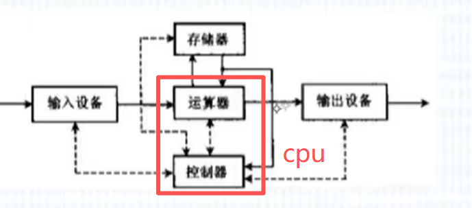
   
   此处总线相关可查看：[1.7 总线系统](#1.7 总线系统)
   
   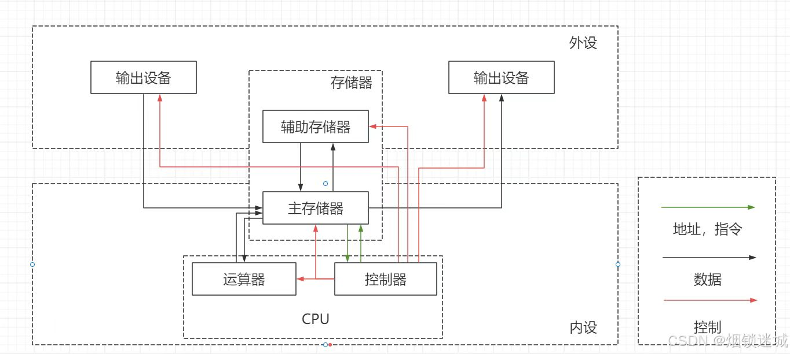

冯.诺依曼计算机的特点:

1. 计算机由五大部件组成:

2. 指令和数据以同等地位存于存储器，可按地址寻访

3. 指令和数据用**二进制**表示
4. 指令由操作码和地址码组成

5. 存储程序

6. 以运算器为中心

输入/输出设备与存储器之间的数据传送，通过运算器完成。

2. 五大部件的功能构成：

   （图源：学以致知Learning）

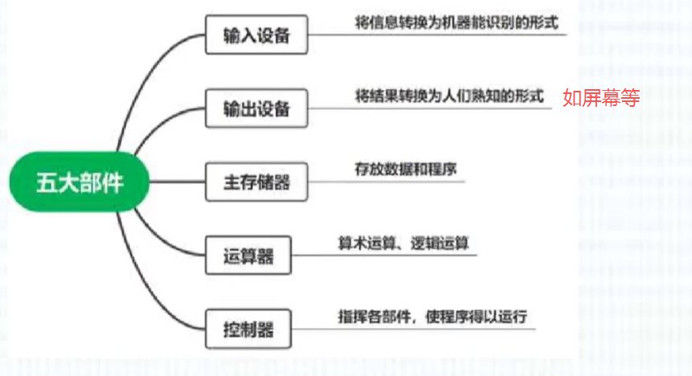

### 1.5.1 主存储器（内存）

1. 主存储器图示：

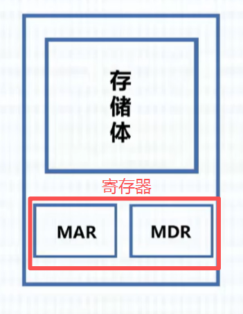

2. 存储体的组成部分：

- **存储元:** 即存储二进制的电子元件，每个存储元可存**1bit**。

- **存储单元:**  每个存储单元存放 <u>8位 存储元</u>。

- **存储字(word):**  多个（1,2,4,8）<u>存储单元</u> 构成一个存储字，代表着cpu一次性能够读写的位数

- **存储字长: **衡量存储字的位数

  

3. cpu中的寄存器

- **MAR:**地址寄存器 （Memory Address Register）
  - 长度 = 字长，假设MAR有n位 ，则可以访问  2^n^  个存储单元
- **MDR:**数据寄存器（Memory Data Register）
  - MDR大小 = 字 = 存储字可以存放的 bit(位）数
  - MDR **规定了** 存储字可以存放的位数


CPU 对存储器的读写过程：

- **注意**：存储器和寄存器不是同一东西
  - 寄存器：位于CPU内
  - 存储器：外部器件，一般指内存


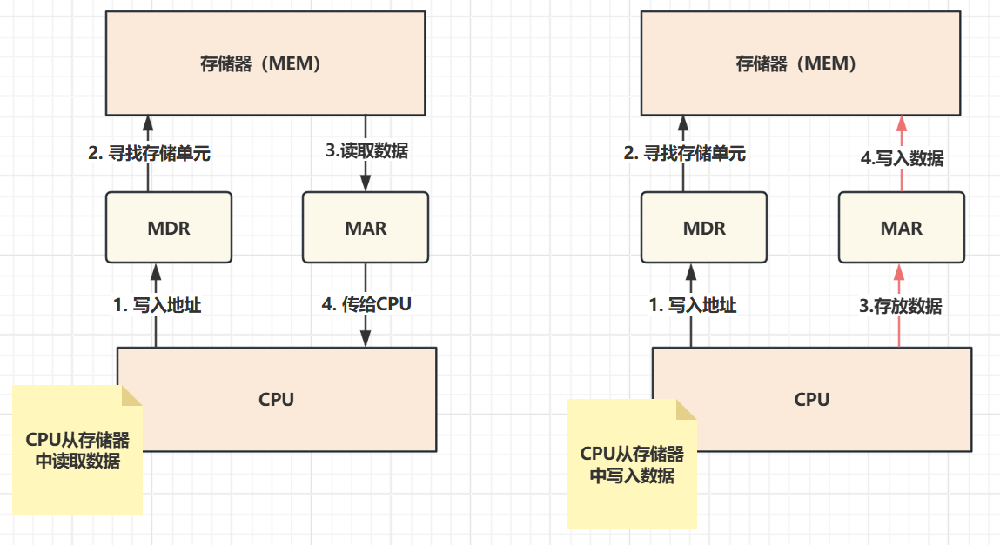


4. 关系图解：

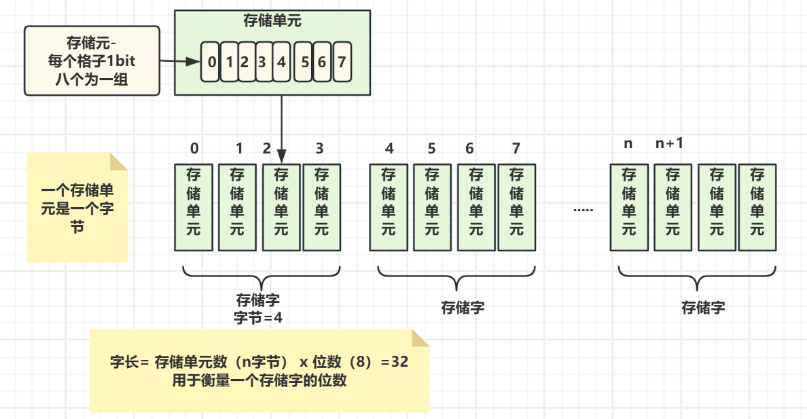


5. 单位关系：

- 1bit (位) x 8 = 1 byte(字节)   ， 即 8bps  = 1Bps （此处bps和Bps是网络传输速度的单位）
  - bps ：**bit per second**  **（比特每秒）**
  - Bps：**Byte per second（字节每秒）**

- 1byte x MDR(字节数) = 字

-  单位关系图：

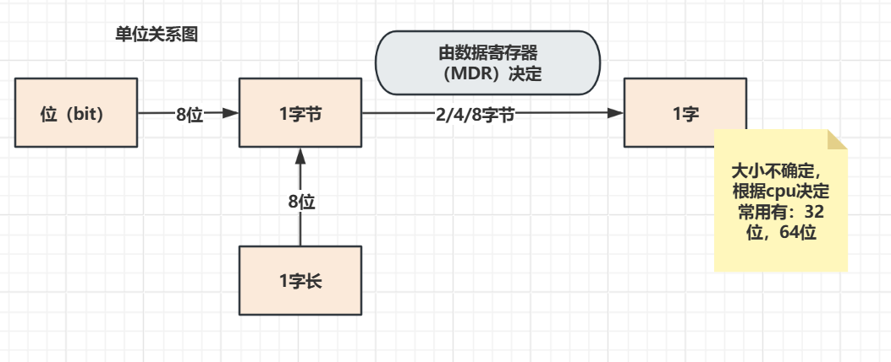


### 1.5.2 CPU-运算器

1. 定义：运算器（ALU）是CPU中用于处理算术（加减乘除）和逻辑（与或非）运算的

2. 运算器图解：

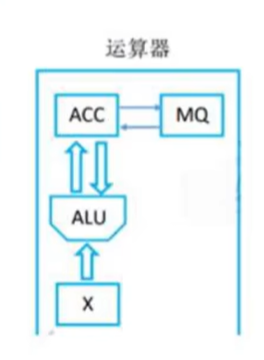

3. 各部分功能解释：

- ALU：**算术逻辑单元**，通过内部复杂的电路实现算数运算、逻辑运算。负责<u>主要的计算处理</u>

​	(**Arithmetic Logic Unit**)

- ACC：**累加器，**用于存放操作数，或<u>运算结果</u>。

  (**Accumulator**)

- X：**通用的操作数寄存器**，用于存放操作数。通常和ACC一起存放一个数据提交给ALU（如图所示），在存储层次结构中排最高位

  (**Register X** )

- MQ：**乘商寄存器**，在乘、除运算时，用于存放操作数或运算结果。平时不常用，主要用于乘商运算中，比如乘法结果通常有高位和低位，ACC存一部分，MQ存另一部分。

  (**Multiplier-Quotient Register**)

- DR：**数据缓存寄存器**。用来暂存从内存读取过来、准备送进运算器的数据，或者准备写回内存的数据。

  (**Data Register**)

- PSW：**状态条件寄存器**，用来保存指令运行标志。不存放数据，只存放状态

  (**Program Status Word**)


4. 案例理解：

假设在运算器中完成：A+B的操作

- 数据A存放在 ACC中，数据B放在X中
- ACC和X 把A，B同时提交给ALU
- ALU 计算出 A+B 的结果C
- 把结果C返回给ACC存储
- PSW 评估结果状态（如是否溢出等)


### 1.5.3 存储层次结构：

1. 定义：存储层次结构（Memory Hierarchy）为了解决**“容量、速度、成本”**的不可能三角，依据**时间局部性** 和 **空间局限性**，

   ​	系统把最近用到的数据放在最快、最贵的存储器里

   ​	把暂时不用的数据“降级”到慢速、便宜的存储器里

   - **时间局限性：**如果某个数据项被访问了，那么它在不久的将来极有可能再次被访问。（例如：代码中的循环变量、重复调用的函数）
   - **空间局限性：**如果一个内存位置被访问了，那么它相邻的内存位置极有可能很快被访问。（例如：遍历数组、顺序执行的指令）

- 层次结构和性能图示：

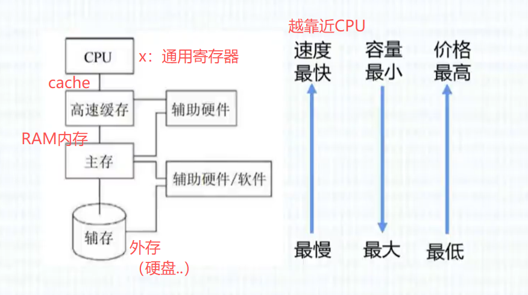

2. ==存储器层次划分：==

划分依据：从到CPU近（性能要求高） 到 CPU 远（性能要求低），从**高到低**如下划分

- CPU寄存器 (Registers)：X
- 高速缓冲存储器 （Cache Memory）：一般会有三层缓存
- 主存储器（RAM内存）
- 辅助存储器（外存：如硬盘等）
  - 介质：闪存（SSD） ,磁存储(HDD) 等
- 离线存储（如光盘，磁带等）


3. 速度与容量

- CPU - Cache - 主存（RAM）

​	在使用过程中会发现，CPU的速度极快，但容量较小，主存（内存）容量相对高，但是速度跟不上CPU，因此在它们中间安排了缓存(cache)

​	通过把部分CPU常用数据存储在Cache里，来提升效率

​	**数据交换：**CPU和Cache 之间的数据交换，由**CPU自己的内部硬件完成**，无需外部程序

​	其中，数据的流通过程是这样的：

​	1）CPU 优先去Cache寻找数据，找到（命中）数据，就直接返回

​	2）若未能在Cache里找到数据（未命中），CPU则会去主存（RAM）里寻找。并把找到的数据复制一份放在Cache，以便下次使用

​	3）如果主存里也没有找到，**操作系统（OS）**[^注5]会去辅存（硬盘）里寻找

- 主存 -辅存

​	主存（RAM）相比CPU容量更多，但是主存价格高昂，其次**断电后会丢失数据**[^注4]。为了解决这个问题，便引入了硬盘（**虚拟存储系统**），其特点是：容量大，价格相对低廉

​	**数据交换**：**硬件 + 操作系统（OS）共同完成**，操作系统（OS）用代码来调度，硬件提供支持

​	

- 关系图：

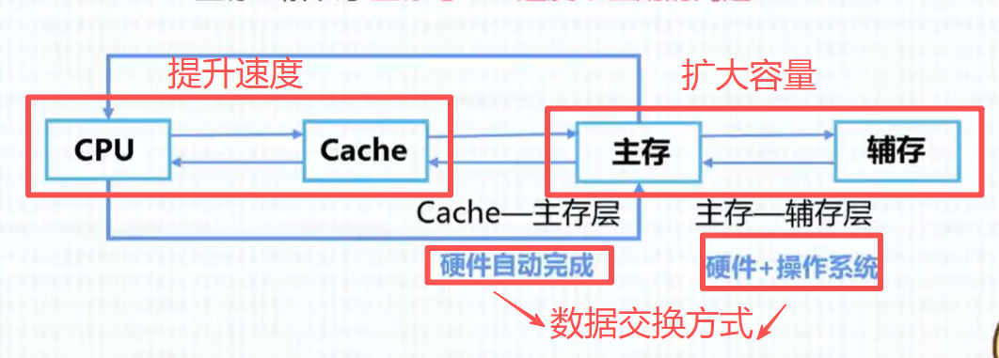


### 1.5.3 CPU-控制器

1. 控制器的组成图解：

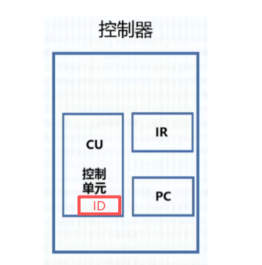

2. 各部分功能解释：

- CU:**控制单元**，分析指令，给出控制信号。

  (**Control Unit**)

- IR:**指令寄存器**，存放**当前执行的指令**。

  (**Instruction Register**)

- PC:**程序计数器**，存放**下一条指令地址**，**有自动加1功能**。

​	(**Program Counter**)

- AR:**地址寄存器**，保存当前CPU所访问的内存单元地址。

  (**Address Register**)

- ID:**指令译码器**，对操作码进行分析。ID的物理部件是在CU内部的

  (**Instruction Decoder**)

3、 流程功能：

**完成一条指令 = 取指令 → 分析指令 → 执行指令**

- 取指令：PC给出地址，从内存取出地址放入IR
- 分析指令：ID对IR中的指令进行分析，CU发出控制信号
- 执行指令：执行具体操作

4. 考点：

1）给出部件名称，判断属于运算器还是控制器

**控制器部件：**CU(控制单元)，IR(指令寄存器)，PC(程序计数器)，AR(地址寄存器)，ID(指令译码器)

**运算器部件：**ALU(算术逻辑单元)，ACC(累加器)，X(通用操作数寄存器)，MQ(乘商寄存器)，DR(数据缓存寄存器)，PSW(状态条件寄存器)

2）给出功能，写出对应名称


### 1.5.4 Flynn分类法

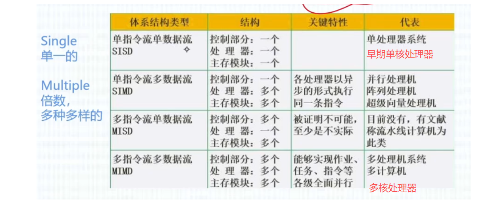

- 快速记忆：S：单一的 Single , M ：多样的 Multiple， I：指令-Instruction  ，D：数据 Data  ，**前指后数，ID不变，SM变化**

1. **关键特性：**

- SISD： 各处理器以**异步**的形式**执行同一条指令**
- MIMD：能够实现作业、任务、指令等**各级全面并行**
- MISD：被证明不可能，至少是不实际

1. 理解记忆：

- SISD（单指单数）：相当于一个领导(指令），指导一个人干活（数据流）
- MISD(多指单数) ：**理论可行实际不可行**，相当于多个领导指挥一个人干活，效率低下


### 1.5.5 存储系统的分类

1. **按位置分类:** 可分为内存和外存。

- 内存(主存):用来存储当前运行所需要的程序和数据，**速度快，容量小**。

- 外存(辅存):用来存储当前不参与运行的数据，**容量大但速度慢**。

  

2. **按材料分类:**  可分为磁存储器、半导体存储器和光存储器。

- 磁存储器: 用磁性介质做成，如磁芯、磁泡、磁盘、磁带等。
- 半导体存储器: 根据所用元件又可分为双极型和MOS型两类;根据是否需要刷新又可分为静态和动态两类。
  - 静态（SRAM）：极快，但极其昂贵且容量小。**用于Cache（缓存）**
  - 动态（DRAM)  ：速度稍慢，便宜，集成度高。需要不断刷新才能保存数据。**用于主存（内存条）**。
- 光存储器: 由光学、电学和机械部件等组成，如光盘存储器。


3. **按工作方式**：可分为读/写存储器和只读存储器。

- 读/写存储器(RAM)[^注7]：又叫随机存储器，它既能读取数据也能存入数据的存储器，但是断电会丢失所有数据（可以**读写**）
- 只读存储器(ROM)：工作过程中仅能读取的存储器，（**只读**）


4. **根据数据的写入方式**：ROM又可细分为**ROM、PROM、EPROM和EEPROM**等类型。

- 固定只读存储器(ROM)：这种存储器是在厂家生产时就写好数据的，其内容**只能读出，不能改变**。

  一般用于存放系统程序BIOS和用于微程序控制。（如出场时的引导程序）（**只读**）

- 可编程的只读存储器(PROM)： 其中的内容可以由用户一次性地写入，写入后不能再修改。（**可一次性读写，不可修改**）

  

以下可修改的存储器，都需要特殊方式修改，无法在计算机运行中随时修改

- 可擦除可编程的只读存储器(EPROM)：其中的内容既可以读出，也可以由用户写入，写入后还可以修改，**紫外线照射擦除信息**。

  （**可读写+修改**）

- 电擦除可编程的只读存储器(EEPROM)：（E: Electronic）

  与EPROM相似，EEPROM 中的内容既可以读出，也可以进行改写，**电擦除的方法进行数据的改写**

  （**可读写+修改**）

- 闪速存储器(Flash Memory)： 简称闪存,闪存的特性介于EPROM和EEPROM之间，类似于EEPROM,也可使用电信号进行信息的擦除操作。整块闪存可以在数秒内删除，速度远快于EPROM。

  （**可读写+修改**）


### 1.5.6 高速缓冲 Cache

1. 定义：高速缓存(Cache)是位于<u>CPU和主存之间</u>的高速存储子系统。

2. 功能：采用高速缓存的主要目的是: **提高存储器的平均访问速度**，使存储器的速度与CPU的速度相匹配。

​		  Cache的存在对程序员是透明的，**其地址变换和数据块的替换算法均由硬件实现**。

​		  通常Cache被集成到CPU内，以提高访问速度，其主要特点是**容量小、速度快、成本高**。

3. 查看：在电脑-任务管理器-CPU中可以看到电脑的缓存配置，常用的有三级Cache

   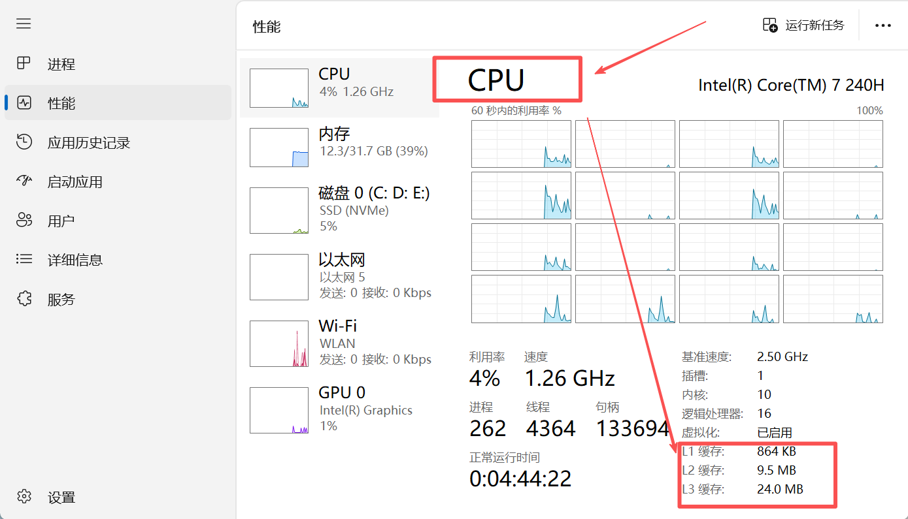

   - L1：最靠近CPU，速度快，容量小，通常分为：数据缓存和指令缓存
   - L2：速度略慢，容量大一些
   - L3：速度最慢，但有多个核心，容量最大

4. 组成：

-  Cache存储器部分：用来存放**主存的部分复制信息**。

  （易错：注意存放的是**复制信息**，Cache**不是主存的扩展**，不会存放新的信息，只会存放主存已有的信息）

- 控制部分：判断CPU要访问的信息**是否在Cache存储器中**，若在，即为命中（Hit），若不在则没有命中（Miss)

  

#### 1.Cache三种地址映射方式：

定义：**即把主存中的地址映射成Cache存储器中的地址**因为处理机都是**按主存地址**访问的，而应从Cache存储器中读写信息，因此就需	   要地址映像，地址映像方法有三种

​	 **地址映射是由硬件自动完成的**

常用公式：

- Offset:

$$
2^{Offstet} = 块大小
$$

- Index:

$$
2^{Index}=Cache总块数
$$

- Tag

$$
Tag位数
=
总地址位数
−
Index位数
−
Offset位数
Tag位数=总地址位数−Index位数−Offset位数
$$

- Cache总块数：

$$
Cache总块数 = 总容量 ÷ 块大小
$$


1. 为了建立Cache的映射，需要先把**主存地址**（主存块号+块内地址） 拆分：[^注9]
   $$
   主存地址/Cache地址结构 = Tag （区号）  +  Index （Cache行号） + Offerst （块内地址）
   $$

   - Tag : 区号，主存块号剩下的高位，存储在Cache中，用于**对比验证**，它可以用来区分当前存放的是哪个主存的高位。

     ​	Tag = 主地址总长 - Offset - Inedx，取高位

     例如在直接映射中：主存第4块  和 主存第16块被放到了Cache的第 0 块中，该如何区分它们呢？

     此时便需要用它们的高位（Tag）[^注8]来区分两者的不同

   - Index : 即块号，它直接定位 Cache 中的哪一行（物理槽位） Index = 主存地址中间12位

     总行数 = 总容量 ÷ 块大小

   - Offset ：定位该块内的具体字节，是主存地址的低四位

   **除此之外，还有个有效位，用来表示数据是否有效：**

   - 有效位**（Valid Bit）**：1表示有效，0表示无效

     

2. **Cache 块总数 ：**其中`每块的大小`是主存和Cache交换数据时的数据单位：块(Block)

$$
Cache 块总数 = \frac {Cache总容量} {每块的大小}
$$

​	假设 每块（Block） = 16 B， Cache总容量 = 64 KB = 1024 * 64 = 65536 B

​	Cache总块数 =   65536 B ÷ 16B = 4096块

​	（注意：<u>主存的总块数的计算方法和Cache是一样的</u>，把Cache总容量换成 主存容量 就好）


1. **直接映像**：（主存的数据块号  ÷  Cache块总数 , 取余 = 对应的Cache块地址 ）

   就是主存的块与Cache中块的**对应关系是固定的**（计算得出），主存中的块只能存放在Cache存储器的固定块号中。

   在**有效位（Valid Bit）为 1**的前提下， 主存地址中的**主存区号**（Tag）与**Cache该行中保存的Tag**相同，则表明访问Cache命中（Hit）。


- 案例：假设主存有1000个数据，Cache 只有 10 个块，直接映射的分配方式是取余数：
  - `主存数据n  ÷  Cache总块数` ，**取出结果的余数，就是该数据对应的块**
  - 如案例中的10号数据，10÷10余0，100号数据：100÷ 10 余0 .....以此类推，**所有余数=0的数据都放入 Cache的0号位中**

- CPU如何去Cache中找到数据：假设要找的是 10号数据

​	1）通过计算得到 10号 数据在Cache 中对应的 **块号**：0 

​	2）查看 块号0的有效位：如果是1就继续查找，如果是0则不继续

​	3）找到块号 0 之后，判断 Tag（区号）是否相同，如果相同，则命中（Hit）

- 优点： 地址变换很简单

- 缺点：灵活性差，极容易发生冲突（抖动）

  例如：主存里有 n 和 2n，3n.... 都映射到了同一个Index上（如 0 块号），如果先放了 n，再放 2n 的时候就要把 n 从0号位上踢出，导致交替访问时命中率极低（抖动）

- 图示：

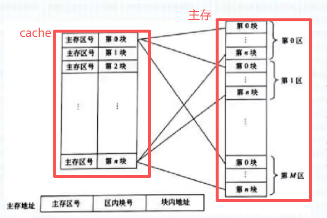


2. 全相联映像: **允许主存的任一块可以调入 Cache的任一块的空间。**在地址变换时，将主存地址高位表示的主存块号与Cache中的主存块号进行比较，若相同则为命中。

   全相联映象没有位置的限制，因此   主存地址= Tag(块号) + Offset （块内地址），无需Index

- 优点：主存的块调入Cache的位置不受限制，命中率高，十分灵活，不会出现抖动现象
- 缺点：是无法从主存块号中直接获得Cache的块号（因为没有Index），需要将Cache遍历才能找到对应的Tag[^注10]。变换比较复杂，**速度比较慢**。

- 图示：

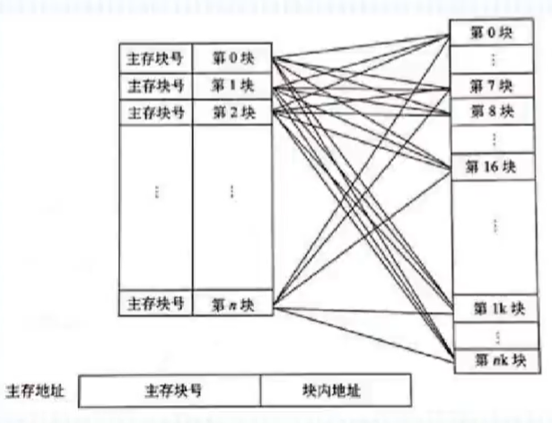


3. 组相联映像: 这种方式是前面两种方式的折中。具体方法是将Cache先分成组再分块。

   ​		     **组间采用直接映像方式，而组内的块采用全相联映像方式**

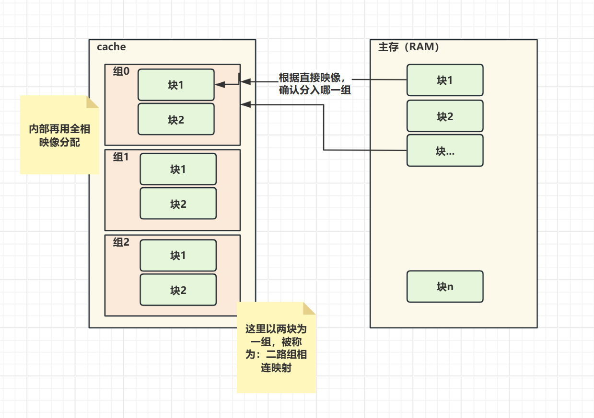


#### 2.Cache的性能分析

1. 若H为Cache的命中率， t~c~ 为Cache的存取时间，t~m~ 为主存的访问时间[^注11]，则Cache的等效访问时间 t~a~ 为：
   $$
   t_a =  Ht_c +(1-H)t_m
   $$
   
   这个公式相当于一个加权平均数，即：
   
   - （1-H）：缺失率，即未命中（MIss）的概率
   - Ht~c~   ：有H的概率（命中的概率），CPU取数据只需要tc的时间
   - （1-H）t~m~  : 有（1-H）的概率（即未命中的概率），CPU取数据需要t~m~的时间
   - 把两者相加，就可以得到所有情况（命中+未命中），预期中CPU取数据的时间
   
   

2. 使用Cache比不使用Cache的CPU访问存储器的速度提高的倍数r，可以用下式求得

$$
r =  \frac {t_m} {t_a}
$$

​	t~m~ ：不用Cache的时间

​	t~a~ ：用Cache的时间

- **加权平均算时间，主存除平均算加速**


#### 3. 案例分析

1. 案例1：

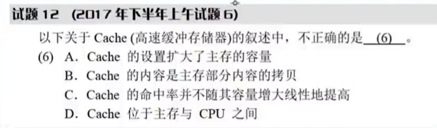

- 答案：A
- 分析：
  - A ：Cache不会扩大主存容量，而是放了一些主存内容的拷贝
  - C：受 "局部性原理"的限制，随着Cache容量的增加，命中率会越来越高，但是提升也会越来越小，存在边界递减效益，**并不会线性提高**

2. 案例2：

   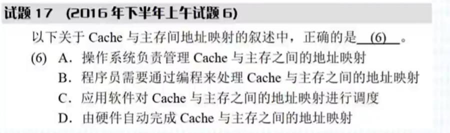

- 答案：D
- 分析：
  - 此题为概念考察题，牢记：**Cache和主存间的地址映射是硬件自动完成的** 即可


### 1.5.7 主存的扩展

1. 主存储器的示意图：

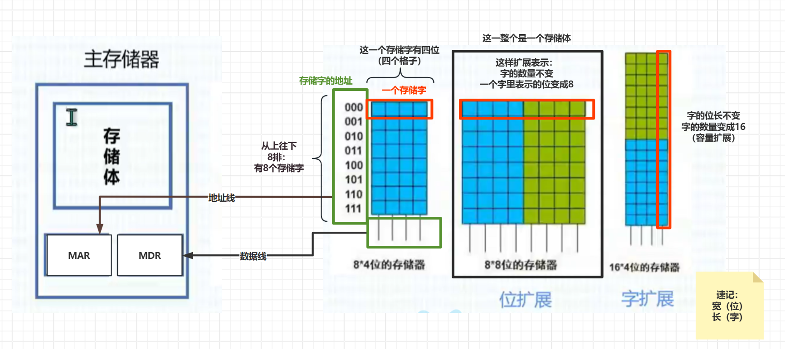

2. 详解：

- 8*4位存储器：
  - 8 : 表示**存储字**的**数量**（横着一排）
  - 4：表示存储字的**容量**（一排里格子的数量）
- 地址线：地址线是从存储体连接到MAR寄存器的，**其数量根据存储字的数量决定**：
  - 如图片里 8*4 位存储器，说明有8个存储字，即有 2^3^ 种二进制的组合，需要3根地址线[^注12]
  - 而 16*4 位的存储器，则需要 2^4^, 也就是四根地址线
- 数据线：**数据线的数量 = 存储字的容量**。 
  - 如 8* 4 位存储器的数据线，就有4根数据线
  - 如果位扩展中，存储字的容量变成了8位，那就有8根数据线


3. CPU如何从存储器中寻找数据

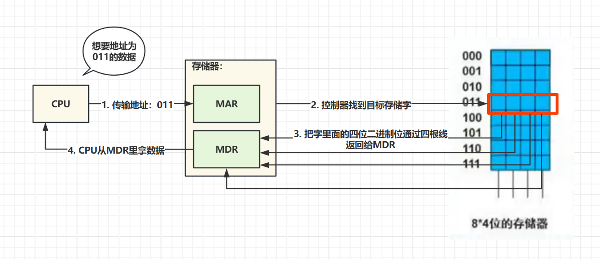


4. 案例题：
   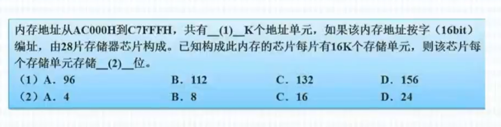

分析：

- 第一空

1）内存地址从AC000H到C7FFFH，从H可以判断出，这是两个16进制数。要算出其中有多少个地址单元，则要用后面的C7FFF减去AC000，求出其中的差值：1BFFF

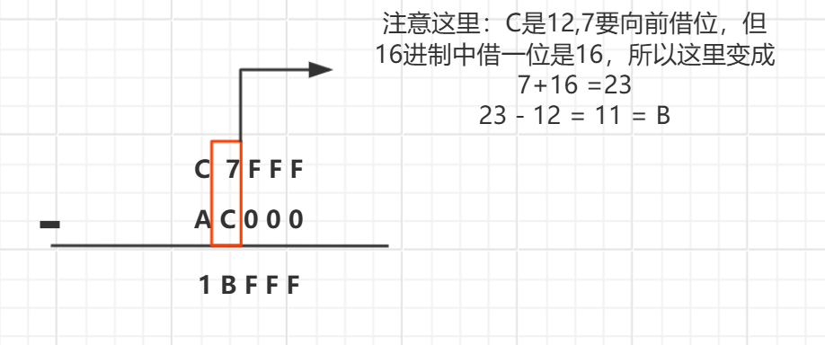

2）得到结果后要 +1[^注13]

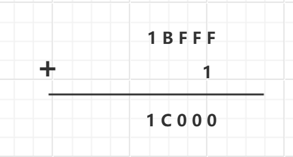

==3）==结果的单位是K，相当于把十进制数÷1024，但是在二进制中，把二进制数÷2^10^ ，就可以直接得到结果，所以这里先用 8421的方法把 16进制转化成二进制

```
1C000 = 0001 1100 0000 0000 0000
```


4） 把得到的二进制数 ÷ 2^10^， 所以要剔除上面得到的二进制位的后十位，得到

```
0001 1100 0000 00
```


5）最后把这个二进制数转化成十进制：

| 位权 (n)   | 9    | 8    | 7    | **6** | **5** | **4** | 3    | 2    | 1    | 0    |
| :--------- | :--- | :--- | :--- | :---- | :---- | :---- | :--- | :--- | :--- | :--- |
| **二进制** | 0    | 0    | 0    | **1** | **1** | **1** | 0    | 0    | 0    | 0    |

得到： 2^6^ + 2^5^ + 2^4^ = 64+32+16=112

最终答案：B 


- 第二空：

1）根据题目信息：按字16bit编址,意思就是每个地址单元可以存放 16位（b）的数据，根据上一空得到的地址单元数量，可以得到该内存的总容量： 地址单元数(K) * 每个地址单元的大小(b)

```
112K * 16b
```

2）题目中提到：该内存有28个芯片，那通过：总容量 ÷ 芯片数，就可以得到每个芯片的容量大小= 

```
（112K * 16b） ÷ 28
```

3）题目中提到：每个芯片有16K个存储单元（相当于16K个小格子），最终要求得每个存储单元的容量，则是：

每个芯片的容量 ÷ 每个芯片的存储单元数量（格子数量）
$$
\frac {112K * 16b} {28 * 16K}
$$
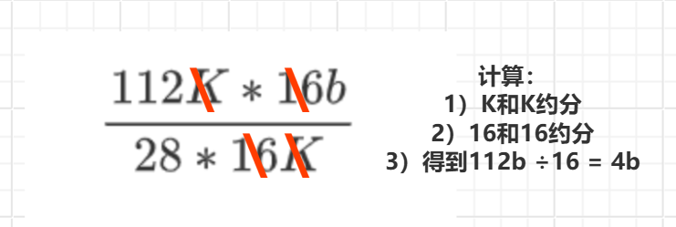

4）最终答案选择：A，4位(b)


### 1.5.8 虚拟存储器

1.定义：虚拟存储器是由**主存、辅存、存储管理单元及操作系统中的存储管理软件组成的存储系统**[^注14]。

程序员使用该存储系统时，可以使用的内存空间可远远大于主存的物理空间，但实际上并不存在那么大的主存，故称其为虚拟存储器。

- 功能：虚拟存储器使存储系统**既具有相当于外存的容量又具有接近于主存的访问速度**。


2. 注意：

- 虚拟存储系统**不能扩大物理内存容量**，而是扩充了 **逻辑地址空间**


3. 和Cache的对比

|            | 作用               | 管理          |
| ---------- | ------------------ | ------------- |
| Cache      | 提高速度           | 硬件          |
| 虚拟存储器 | 解决容量和速度问题 | 硬件+软件(OS) |


### 1.5.9 磁盘存储器

1. 磁盘结构图：

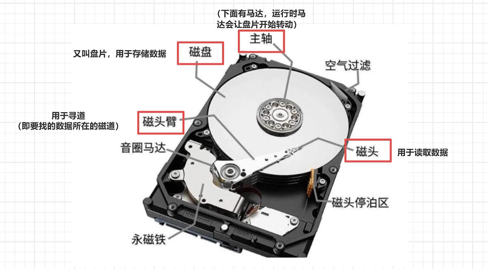

（图源网络）

2. 盘面的功能和结构：

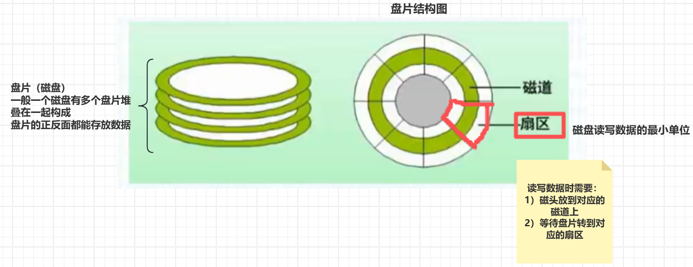

- 柱面：盘片上**所有半径相同的磁道**叠加起来，形成的圆柱体。**磁头在同一个柱面上切换盘面，不需要寻道**（因为磁头臂不用动），在读写大文件时，按柱面读取速度最快

3. 存取时间公式：

$$
存取时间 = 寻道时间 + 等待时间(即平均定位时间+转动延迟)
$$

- 寻道时间：是磁头移动到磁道所需的时间
- 等待时间：等待读写的扇区转到磁头下方所用的时间

## 1.6 指令

1. 定义：指令(又称机器指令) 是指示计算机执行某种操作的命令，是计算机运行的**最小功能单位**。

   指令集：一台计算机的**所有指令的集合**，构成该机的指令系统，也称为指令集。

2. 简单示意图：

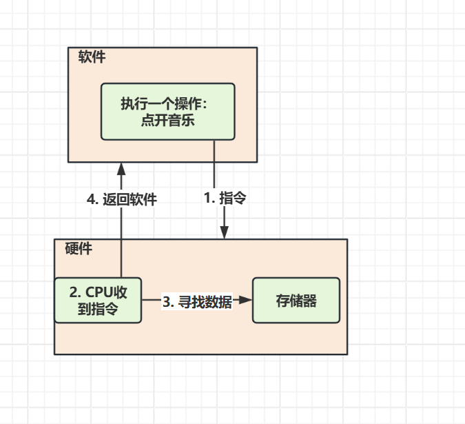

3. 指令的格式：一条指令就是机器语言的一个语句，它是一组有意义的**二进制代码**。

   ​		       一条指令通常要包括**操作码字段**和**地址码字段**两部分:

- 操作码 (OP) ：指明操作的类型，操作码位数越多，能表示的指令越多

  操作码=n时，能表示的指令 = 2^n^ 个

- 地址码 (A) ：主要指明**操作数**，及运算**结果存放的地址**

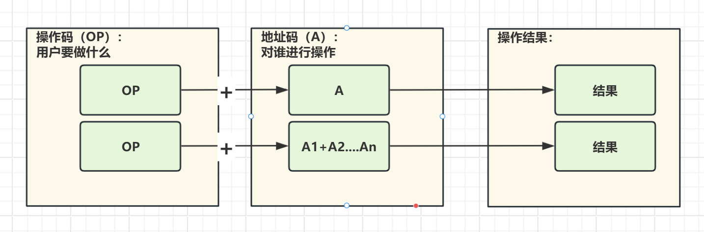

4. 地址码的四种类型：

- 零地址码指令：OP ，没有地址码，一般用于**中断，停机**指令，因为没有操作对象
- 一地址码指令：OP + A ，如自增（+=1），求反等操作，其中A即是操作数，也是结果存放处

- 二地址码指令：OP+ A1 + A2 ，如：A1 = A1 + A2，在二地址码指令中，往往会把返回的结果==**覆盖其中一个操作数 **(覆盖原先数据)==

- 三地址码指令：OP + A1 +A2 +A3 ，如：A1 + A2 = A3


5. 指令字长：指的是一条指令所包含的二进制位数，**指令字长 = 操作码位数  + 地址码位数**（可能有多个）

- 定长指令字结构：即所有指令的字长相同，使用起来控制简单
- 变长指令字结构：指令的字长不同，节省存储空间，但是控制麻烦


6. **拓展操作码：**

- 定义：地址码越长，则操作码越短，那么指令就越短。为了在有限的位数内表达更多指令，可以把地址码中没有用上的位数借给操作码

- 案例分析：

​	“已知指令字长为16位，地址码各占4位，若需要15条三地址指令，12条二地址指令，求操作码最少需要几位？” 


### 1.6.1 七种寻址方式

1. 定义：寻找指令中操作数[^注1]有效地址的方式。即：指令发出"完成A+B"的操作，但是并没有给出A，B的有效地址，就要借助以下的寻址方式来找到对应的地址
   - **有效地址（EA）：** **数据真正在内存里的物理地址**

2. 具体分类：

1）**第一种：操作数在不在内存中**

- **立即寻址:** 操作数作为指令的一部分**直接写在指令中**，这种操作数称为立即数。

  - 即指令里包含了数据，不需要内存去寻找
  - 案例：`MOV AX, 1234H` （把数字1234H直接放进AX寄存器）
  - 优点：速度最快
  - 缺点：数字大小受限（指令长度有限）
  - 访存次数（访问内存）：0

- **寄存器寻址:** 指令所要的操作数**已存储在某寄存器**中，或把目标操作数存入寄存器。

  - 操作数在寄存器里，即在CPU内部，因此CPU可以不用去内存寻找
  - 案例：`MOV AX, BX` （把BX里的数据放到AX里）
  - 优点：速度快
  - 访存次数（访问内存）：0

  

2）**第二种：操作数在内存中，直接给出地址**（区分第三种间接给出地址）

- **直接寻址: **指令所要的操作数存放在**内存**中，在指令中（地址码）直接给出该操作数的有效地址

  - 指令里直接写了数据在**内存中的绝对地址**。

  - 案例：`MOV AX, [1000H]` （去内存地址1000H的地方，把数据拿来放到AX）

  - 优点：使用简单

  - 缺点：受地址码位数限制，**寻找范围有限**

  - 访存次数（访问内存）：1

    

3）**第三种，操作数都在存储器中（内存），间接给出地址**

​	访存次数（访问内存）：1

- **寄存器间接寻址:** 操作数在存储器中，操作数的有效地址用SI、DI、BX和BP[^注2]**四个寄存器之一来指定**。

  - 把操作数的**内存地址**放在**寄存器**中，即要先找到对应的寄存器里的地址，才能找到数据
  - `MOV AX, [BX]` （去BX寄存器中找到地址，放到AX中）。
  - 优点：比直接寻址更加灵活，可以修改寄存器里的值来指向不同的地址

  

- **寄存器相对寻址**: 操作数在存储器中，其有效地址是一个基址寄存器或变址寄存器中的内容和指令中的8位/16位偏移量之和。

  - 寄存器里的值 + 指令里的偏移量 = 内存地址
  - **公式**：`EA = (寄存器) + 偏移量(8位/16位)`
  - `MOV AX, [BX+8]` （去BX寄存器里的地址，再往前走8步，才能拿数据）
  - 辅助理解：如在 路牌100号(**寄存器里的地址**) 上看到备注 “往前八步（**偏移量**）是车站 （**数据**）”
  - 优点：适合**查数组**。寄存器存数组的首地址，偏移量就是数组下标

  

- **基址加变址寻址方式:** 操作数在存储器中，其有效地址是一个基址寄存器和一个变址寄存器的内容之和。

  - 两个寄存器的值加起来 = 内存地址
  - **公式**：`EA = (基址寄存器) + (变址寄存器)`
  - `MOV AX, [BX+SI]` （把BX和SI里的数字加起来，得到数据的地址）
  - 应用：常用于**二维数组**或者多重循环。基址代表行首，变址代表列偏移。

  

- **相对基址加变址寻址**: 操作数在存储器中,其有效地址是一个基址寄存器的值、个变址寄存器的值和指令中的8位/16位偏移量之和。

  - 两个寄存器的值 + 指令的偏移量 = 内存地址
  - **公式**：`EA = (基址寄存器) + (变址寄存器) + 偏移量`
  - `MOV AX, [BX+SI+10]` （BX + SI + 10，去算出来的地址找数据）


3. 考点：给出寻址方式的特点，匹配对应的寻址方式


### 1.6.2 指令集计算机 

1. 指令集计算机分为：

- 复杂指令集计算机（CISC）
- 精简指令集计算机（RISC）

2. 属性对比表：

| 属性                     | CISC (Complex)                             | RISC (Reduced)                                    |
| :----------------------- | :----------------------------------------- | :------------------------------------------------ |
| **指令系统**             | 复杂，庞大                                 | 简单，精简                                        |
| **指令数目**             | 一般大于200条                              | 一般小于100条 （只保留最常用指令）                |
| **指令字长**             | 不固定                                     | 定长                                              |
| **可访存指令**(访问内存) | 不加限制（都可以直接访问内存）             | 只有Load/Store（读/写) 指令, 其余只能在CPU内运行  |
| **各种指令执行时间**     | 相差较大，因为**指令长短不一**             | 绝大多数**一个周期内**完成                        |
| **各种指令使用频度**     | 相差较大                                   | 都比较常用                                        |
| **通用寄存器数量**       | 较少                                       | **多**  ，因为大部分指令都在CPU的**通用寄存器**内 |
| **控制方式**             | 绝大多数为**微程序**控制                   | 绝大多数为**组合逻辑**控制                        |
| **指令流水线**           | 可以通过一定方式实现**（不是一定不行！）** | 必须实现                                          |

3. 精简记忆：

- RISC：定长，LS，多寄存器，组合逻辑，必须流水线
- CISC：复杂，200，微程序，可指令流水线


### 1.6.2 指令的控制方式

1. 分类：指令控制方式有顺序方式、重叠方式和流水方式三种。

- 顺序方式：一条条指令按顺序执行，**0重叠**
  - 指令1：“取指、译码、取数、执行”全走完（占用四个时间周期）
  - 指令2开始执行，.....执行完
  - 指令n
- 重叠方式：重叠着去执行，**1重叠**
  - 如下图，指令1在译码的时候，指令2在取指令
  - 但相比流水方式重叠度有限，一次只能让两个步骤同时发生

#### 1 . 流水方式

1. 定义：**多次重叠**

- “流水”可以看在概念上，成是“重叠”的延伸

- 差别仅在于“一次重叠”只是把一条指令解释分解为**两个子过程**，而"流水”则是分解为**更多的子过程**。

  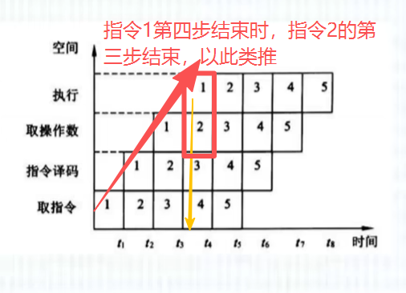

2. 公式：

- **流水线总时间**：一条指令为k段，有n条指令时，流水总时间T符合以下公式

$$
T = K +(n-1)
$$


- **流水线的周期（Δt）取执行时间最长的一段**，那么流水线的时间T就符合以下公式

$$
T = 1条指令执行时间 + (n-1)Δt
$$


- **流水线的吞吐率(**Though Putrate，TP): 是指在单位时间内，流水线所完成的**任务数量或输出的结果数量**。

$$
TP = \frac n T
$$

​	即：TP =指令条数 / 流水线执行时间

- **流水线的加速比（S）**：完成同样一批任务，不使用流水线所用的时间与使用流水线所用的时间之比，称为**流水线的加速比**。计算流水线加速比的基本公式如下

$$
S= 不使用流水线的时间/使用流水线的执行时间
$$

​	不使用流水线的时间：指令步骤总时间 x 指令条数

​	用下面的案例举例： 
$$
S =  \frac{(2+2+1)*100} {5 + (100-1)*Δt}
$$


- 流水线最大吞吐率：当指令条数n无限多时，第一条流水线的建立时间就可以忽略不计，则得到以下公式

$$
TPmax =  \frac 1 {Δt}
$$


3. 案例：一条指令流水线分为三个部分：取指、分析和执行。它们的时间分别是 `2ns`、`2ns` 和 `1ns`。

1）流水线周期是多少？ **答：**2ns ，因为流水周期取执行时间最长的一段

2）100条指令全部执行完毕需要的时间是多少？

解：

​	1条指令执行时长 = t取指 + t分析 + t执行 = 2 + 2 +1 = 5

​	n = 100，Δt = 2

​	带入公式： 5 + （100-1)x 2 = 203 ns


4. 注意：

- 流水方式每一段的**长度都要相等**，否则会发生"堵塞"

- 流水线**不能单独缩短一条指令的时间**，而是**缩短连续执行大量指令的时间**

  

### 1.6.3 输入输出设备

定义：**CPU与外设之[^注6]间的数据传送方式**（I/O）[^注3] ，一共有以下四种方式

1. **直接程序控制方式：**整个输入/输出过程是在**CPU执行程序的控制**下完成的。

   这种方式还可以分为以下两种:

​	(1)**无条件传送方式: **无条件地与CPU交换数据。

​	(2**)程序查询方式**: 先通过CPU查询外设状态，准备好之后再与CPU交换数据。


2.  **中断方式:** 利用中断机制，使I/O系统在与外设交换数据时，CPU无须等待，也不必查询I/O状态，即可以抽身出来处理其他任务，因此提高了系统效率。

   注意：**数据搬运**依旧需要**经过CPU**（外设 -> CPU寄存器 -> 内存）

3. **直接存储器存取方式**(Direct Memory Access，**DMA**)：是在存储器与l/O设备间**直接传送数据**，即在内存与I/O设备之间传送一个数据块的过程中，**不需要CPU的任何干涉**，是一种完全由DMA硬件完成/O操作的方式

   注意：在DMA中，数据搬运不需要经过CPU，**数据只在内存和I/O中传送**


3. **输入/输出处理机** (IOP): 根据主机的I/O命令，完成对外设数据的输入/输出。

   ​					输入/输出处理机是一个专用处理机，用于完成主机的输入/输出操作。

   **IOP是一台拥有自己独立指令系统的专用小电脑**

4. 对比表：

| 传送方式       | CPU参与度            | CPU等待/查询       | 工作效率                          | 适用场景                |
| :------------- | :------------------- | :----------------- | :-------------------------------- | :---------------------- |
| **无条件传送** | 全程控制             | 不查询             | 较高（但适用窄）                  | 极简单的开关量（LED灯） |
| **程序查询**   | 全程控制             | **死等死查**       | **极低**（CPU被绑死）             | 极少数慢速外设          |
| **中断方式**   | 仅负责数据搬运       | **不等待、不查询** | **高**（CPU可并行干别的）         | 键盘、鼠标等随机事件    |
| **DMA**        | 仅初始化和结束时参与 | /                  | **极高**（数据块直接硬件搬运）    | 硬盘、网卡等高速块设备  |
| **IOP**        | 发送总命令           | /                  | **最高**（IOP能独立执行通道程序） | 大型机、海量IO设备      |

5. 案例：

计算机系统中常用的输入/输出控制方式：DMA，中断，程序查询，无条件传送等。这当采用（ D ）方式时，**不需要CPU执行程序指令来传送数据。**

A.中断    B.程序查询    C.无条件传送       D.DMA


## 1.7 总线系统

1. 片内总线**(内部总线)**：片内总线是**CPU芯片内部的总线**。它是CPU芯片内部寄存器与**寄存器之间、寄存器与ALU之间的公共连接线**。

- 特点：速度最快，只在CPU内部

2. ==系统总线：==系统总线是计算机系统内各功能部件**(CPU、主存、1/O接口)之间相互连接的总线**。按系统总线传输信息内容的不同，又可分为3类:
   - 数据总线：可**双向**，用于传输数据
   - 地址总线：**单向**，只能由CPU发出，传向内存或I/O设备。用于传输地址，地址总线的宽度，直接决定了CPU能支持多大内存
   - 控制总线：**单向或双向**，CPU发出 读/写信号

- 特点：速度居中，连接主板上各大部件

**系统总线图示：**


系统总线就是主板上的铜箔走线：

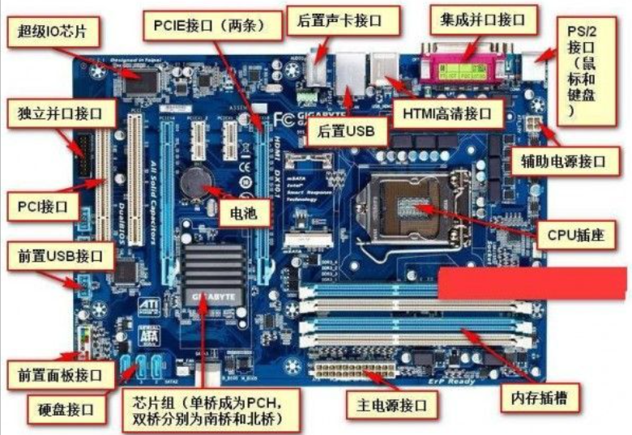

（图源网络）

3、通信总线(**外部总线**): 用于设备一级的互连，计算机可通过该总线和其他设备进行信息与数据交换。

​					如U盘，鼠标，网线等等外部设备

- 特点：距离最远，速度最慢，种类多样


## 1.8 磁盘阵列系统RAID

1. 定义：磁盘阵列**由多台磁盘存储器组成，是快速、大容量且高可靠的外存子系统**。

   （即有多个硬盘组合而成，为实现更好的效能）

   ​	现在常见的独立冗余磁盘阵列(RAID)就是一种由多块独立磁盘构成的冗余阵列。RAID技术分为几种不同的等级，分别可以提供不	同的速度、安全性和性价比。

2. 层级：

|       RAID级       | 说明                                                         |
| :----------------: | :----------------------------------------------------------- |
|     **RAID-0**     | RAID-0 是一种**不具备容错能力**的磁盘阵列（**纯加速，不安全**） |
| **RAID-1（镜像）** | RAID-1 是**采用镜像容错技术**改善可靠性的一种磁盘阵列 （**纯复制，最安全，费用高昂）** |
|     **RAID-2**     | RAID-2 是采用**海明码**进行错误检测的一种磁盘阵列            |
|     **RAID-3**     | RAID-3 减少了用于检验的磁盘存储器的台数，从而提高了磁盘阵列的有效容量。**一般只有一个检验盘** |
|     **RAID-4**     | RAID-4 是一种可以独立地对组内各磁盘进行读写的磁盘阵列，该阵列也只用个检验盘 |
|     **RAID-5**     | RAID-5 是对 RAID-4 的一种改进，它不设置专门的检验盘。同一台磁盘上既记录数据，也记录检验信息。这就解决了前面多台磁盘机争用一台检验盘的问题（允许坏一块盘，**性价比最高）** |
|     **RAID-6**     | RAID-6 磁盘阵列采用两级数据冗余和新的数据编码以解决数据恢复问题，在两个磁盘出现故障时仍然能够正常工作。在进行写操作时，RAID-6 分别进行两个独立的校验运算，形成两个独立的冗余数据，并写入两个不同的磁盘。（允许坏两块盘，**更安全，速度较慢**） |

2. 考点：根据特点写出对应的RAID版本


## 1.9 计算机可靠性

1. 定义：是指从它开始运行(t=0)到某个时刻t这段时间内能**正常运行的概率**，用R(t)表示。

2. 公式：

   - 串联公式：

   $$
   串联部件可靠性 = 各部分可靠度乘积
   $$
   
   - 并联公式：
   
   $$
   并联部件可靠性 = 1 - 部件失效率的乘积
   $$
   
3. 案例题：

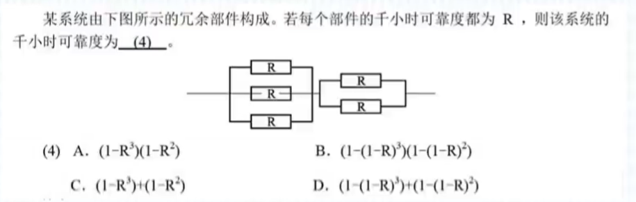

1）根据图片，先把它分为A，B两个部分

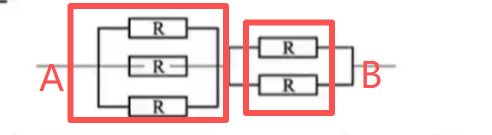  

可以得到: A,B 分别是一个并联的部件，而A和B之间是串联的，于是分开计算

2）根据公式，部件失效率= 1-R，A有三个部件，因此根据并联公式得到A的可靠性
$$
A = 1-(1-R)^3
$$
3）同理得到B：
$$
B = 1-(1-R)^2
$$
4）用串联公式，得到系统的可靠度
$$
[1-(1-R)^3] * [1-(1-R)^2]
$$
因此，此题选B


---

# 2. 数据结构和算法

1. 功能：如何用程序代码把现实世界的问题信息化，如何用计算机高效地处理这些信息从而创造价值。

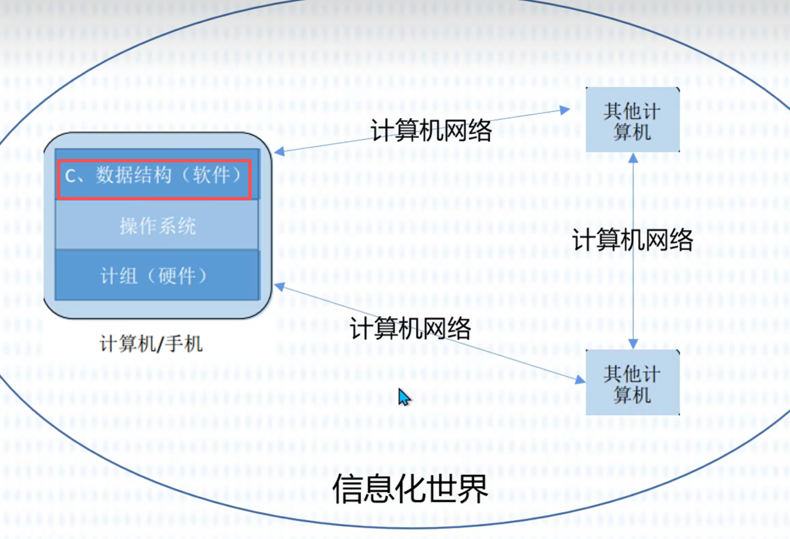

2. 数据的定义：数据是信息的载体，是描述客观事物属性的数、字符及所有能输入到计算机中并被计算机程序识别和处理的符号的集合。**数据是计算机程序加工的原料**。
   - 数据元素：数据元素是**基础单位**，**数据的基本单位**，通常作为一个整体进行考虑和处理。
   - 数据项：一个数据元素可由若干数据项组成，数据项是**构成数据元素的不可分割的最小单位**。


## 2.1 数据结构

1. 定义：相互之间存在**一种或多种特定关系**的数据元素的集合

2. 数据项，数据元素，数据结构的关系图示

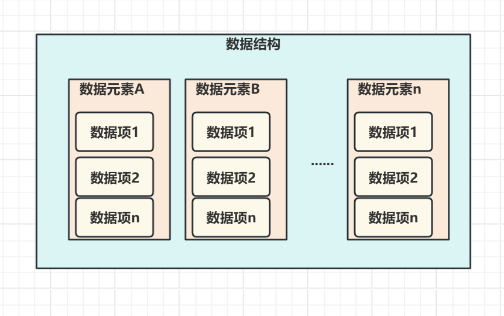

3. 数据结构三要素:

   注意：其中逻辑结构和物理结构都属于线性表：[2.3 线性表](#2.3 线性表)


4. 结构：

- **逻辑结构**：线性表
- **物理结构**（存储结构）：顺序表，链表
- **物理载体**：数组（实现顺序表的工具）

### 1. 逻辑结构

逻辑结构的具体概念可见：[2.3 线性表](#2.3 线性表)

​                                                          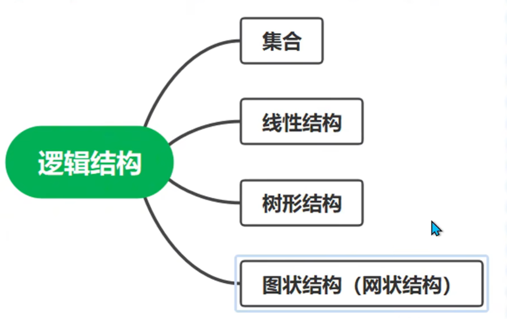

1. 集合：各个元素同属一个集合，别无其他关系

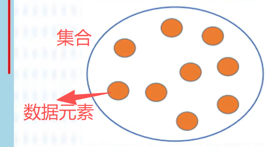

2. 线性结构：数据元素之间是一对一的关系。除了第一个元素，所有元素都有唯一前驱 ; 除了最后一个元素，所有元素都有唯一后继。


3. 树形结构:数据元素之间是一对多的关系

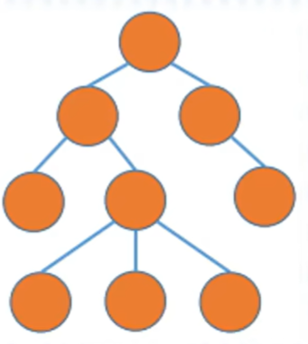

4. 图结构:数据元素之间是多对多的关系

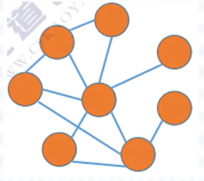

### 2. 物理结构(存储结构)

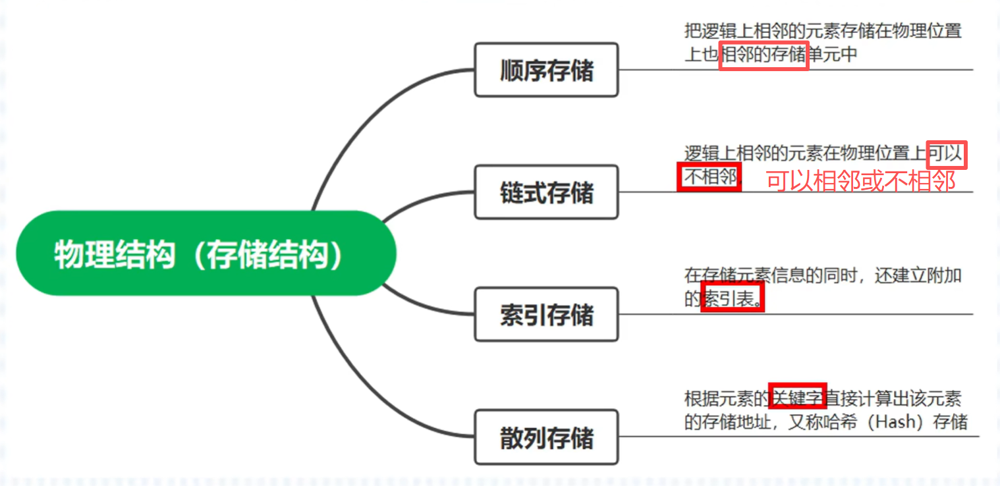


具体内容可见：[2.3.1 存储结构](#2.3.1 存储结构)


## 2.2 算法

1. 算法的功能：用于解决实际问题

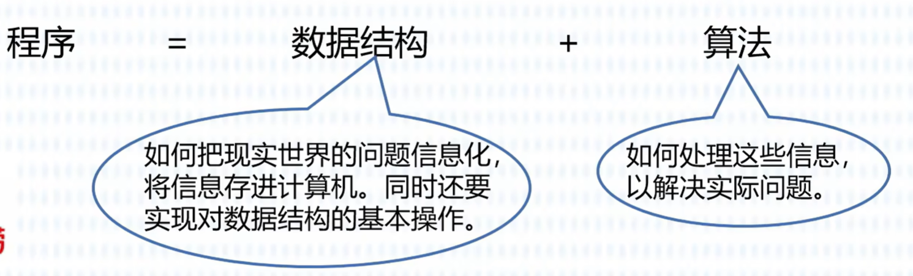

2. 算法的特性

- **有穷性** : 一个算法必须总在执行有穷步之后结束，且每一步都可在有穷时间内完成。**（不可以死循环）**
- **确定性 :** 算法中每条指令必须有确切的含义，**对于相同的输入，只能得出相同的输出**。
- **可行性 :** 算法中描述的操作，都可以通过已经实现的<u>基本运算执行有限次</u>来实现。
- **输入 :** 一个算法有**零个[^注15]或多个输入**，这些输入取自于某个特定的对象的集合。
- **输出:**一个算法有**一个或多个输出**，这些输出是与输入有着某种特定关系的量。


### 1. 算法的效率度量


- 空间/时间 复杂度的速度鄙视链，越靠右侧，耗时越长

​			\(O(1) < O(\log_2 n) < O(n) < O(n \log_2 n) < O(n^2) < O(n^3) < O(2^n) < O(n!) < O(n^n)\)

#### 1. **时间复杂度（T）：**

1. 公式：

- n = 规模
- m = 算法中语句的总数量

$$
T(n) = 语句频度1 + 语句频度2 + ... 语句频度m
$$


2. 案例：

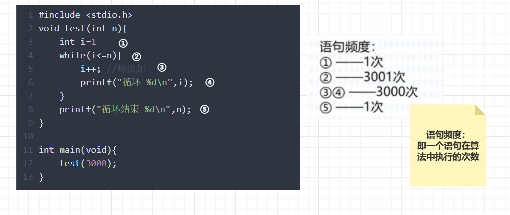

​	时间开销与规模n（3000）之间的关系就是：
$$
T(3000) = 1 + 3001 +3000*2 +1
$$
​	把n带入就是：（这里的n不是指算法中的变量n，而是规模n）
$$
T(n) = 3n + 3
$$

3. 注意: 在实际运用中，当规模够大的时候，常数项的系数，和阶数项最高的系数都可以忽略。多项相加，只保留最高项

​	例如：

- T1(n) = 3n +2     --------> 简化：T1(n) = O(n)  去掉了系数3，和常数2
- T2(n) = 2n^2^ +2n +1000     --------> 简化：T2(n) = O(n^2^)  去掉了最高项系数2，低项n，和常数1000
- T3(n) = n^3^ + n^2^ + 200     --------> 简化：T3(n) = O(n^3^)  只保留最高项n^3^, 其余的去除


4. 快速判断：可以通过算法中循环的个数来判断时间复杂度，

   - 一般如有x个循环，那 T(n) = O(xn)，

   - 循环内嵌套了y个循环，则T(n)= O(n^y^)

#### 2. **空间复杂度（S）：**

1. 定义：无论问题规模怎么变，算法运行所需的内存空间都是固定的常量，不随问题规模 n 的增长而变大

​	如果**算法原地工作[^注16],或是“in-place”算法，那么算法所需内存空间为常量O(1)**，常见的原地工作算法有：冒泡排序，选择排序

​	图示：

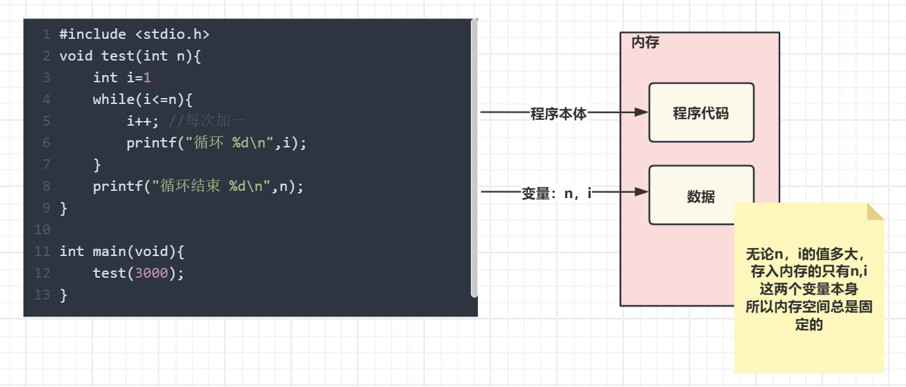


2. 公式：

​	其中O(1) 的1不是指一个字节，而是指占用一个固定的常数空间

​	（S = Sapce）
$$
S(n) = O(1)
$$

3. 快速查看空间复杂度：**只需关注存储空间大小与问题规模相关的变量**

- 没有申请**跟 n有关的数组、链表、矩阵**，只有`int i, j, temp;` 这种单个的变量，那么S(n) = O(1)
- **如果申请了**：`int a[n];` 或者 `int a[n][n];`等，那么空间复杂度：S(n ) = O(n)
- **如果是递归**：要算递归调用的深度（比如递归 n次，每次压栈占一点空间，就是 O(n)

- 函数递归带来的内存开销：

​	空间复杂度 = 递归调用的深度
$$
S(n) = O(n)
$$


#### 3. 案例：

案例1：分析对比以下两个算法的 时间/空间 复杂度

```c
int foo(int n) {
  int sum = 0;

  for (int i = 1; i <= n; i++) {
    sum += i;
  }

  return sum;
}

int bar(int n) {
  if (n <= 0) {
    return 0;
  }

  return n + bar(n - 1);
}
```

结论：foo 的算法效率要优于sum

- foo：
  - 空间复杂度：S(n) = O(1)
  - 时间复杂度：T(n) = O(n)
- sum:
  - 空间复杂度：S(n) = O(n)
  - 时间复杂度：T(n) = O(n)

分析：

1）分析可得，两个算法的功能都是：得到从1+到n的结果

2）foo：

- T(n) = 1 + n(从1+到n需要n步) +1 = 2 + n = O(n)

- S(n) : foo函数里没有申请新的链表等，只有sum和i等单一变量，因此 S(n) = O(1)

3）sum：

- T(n) : sum中的递归一共调用了 n+1次，因此得到的结果是 n+1 = O(n)
- S(n)：这个函数中的递归栈是线性增长的，因此总空间和递归深度成正比，因此S(n) = O(n)


## 2.3 线性表

线性表的结构：

[1. 逻辑结构](#1. 逻辑结构)

[2. 物理结构(存储结构)](#2. 物理结构(存储结构))

特殊线性表：

[2.4 栈和队列](#2.4 栈和队列)

[2.5 串](#2.5 串)

图示：

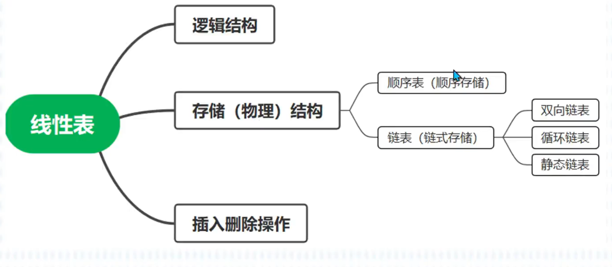

==注意：==**这里的定义是线性表的逻辑结构，也就是逻辑上这些数据元素的关联（一种概念）**

​		**后续所学的存储结构，才是线性表在在内存里是怎么存放的（现实存在）**

1. 定义：线性表是具有**相同数据类型**[^注17]的n(n≥0)个数据元素的**有限序列**[^注18]。

   - n：表长，表示线性表里有多少个元素。当n=0时，线性表是一个空表

     若用L命名线性表，则其一般表示为:

$$
L = (a_1, a_2,...,a_i,a_{i+1},...,a_n)
$$

2. 概念：

   - 位序：a~i~ 是 第i个元素，也就是在线性表中的位序是i 。**位序从1开始**，**但是数组的下标普遍从0开始**

   - a1是表头元素，an是表尾元素

   - 除第一个元素（a~1~) 外，每个元素有且仅有一个直接前驱 ; 除最后一个元素（a~n~）外，每个元素有且仅有一个直接后继

     （类似逻辑结构中的线性结构）


### 2.3.1 存储结构

链表和顺序表的对比

|            | 查找访问速度快 | 插入删除速度快 | 空间利用率                   | 是否支持随机访问                                      |
| ---------- | -------------- | -------------- | ---------------------------- | ----------------------------------------------------- |
| **链表**   | ❌️ O(n)         | ✅️              | 给多少用多少，但存在指针浪费 | ❌️，链表只能根据指针和顺序访问，个别链表可以回退，循环 |
| **顺序表** | ✅️ O(1)         | ❌️              | 容易浪费（扩容或空着）       | ✅️                                                     |

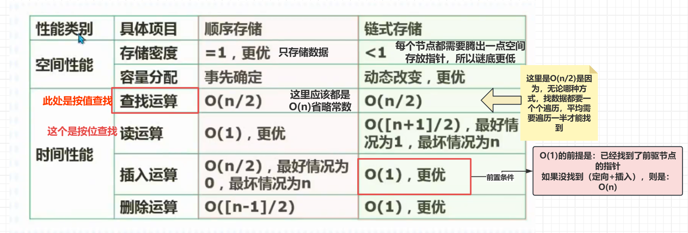

#### 1. **顺序表：**

注意：顺序表并不完全等于数组，本质来说应该是数组+逻辑结构，顺序表本质是**线性表（逻辑结构）的一种顺序存储实现方式（物理结构）**。而数组是实际的物理结构，用于存储

​	  一维数组一般是当作线性表的底层实现

数组相关：[2.6数组](#2.6数组)

1. 定义：内存中**连续**挨着的一块大空间
   - 优点：连续，查找速度快O(1)
   - 缺点：插入和删除麻烦O(n), 如果需要在中间插入元素，那后面的元素都要往后移（排队时有人插队）；

​	    容量固定，如图中的存储空间就是八个，需要一开始就申请足够的空间。

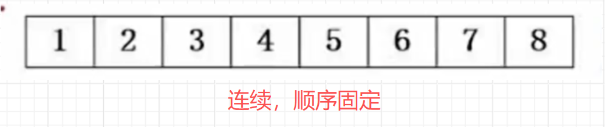

2. 交换顺序：假设3,5交换位置，交换过程如下

​	1）将5的内容先写入临时内存（相当于腾空5格子里的内容）

​	2）把3写入5的格子，把5的内存从临时内存中放回3

3. 插入元素：要移动元素位置，腾出空间，以放入新的元素


---

#### 2.**链表：**

1. 指针域：存放的是下一个完整节点的内存首地址

2. 头指针：必须存在，永远指向链表第一个节点

3. 头结点：有头结点的链表被称为**有头节点链表**（有头），区别如下：
   - 有头：head会指向头结点（也就是一个没有数据的**空节点**），它用于**统一代码的逻辑**。假设在a~1~前插入了一个节点，只需要更改头结点的指向，head永远指向头结点
   - 无头：即没有头结点，在这种情况下，head直接指向a~1~节点。如果要在a~1~前插入一个节点，则需要修改head的指针。在函数里修改表头，则需要二级指针，否则头指针改变无法被知道

| 对比            | 不带头结点（无头）             | 带头结点（有头）                 |
| :-------------- | :----------------------------- | :------------------------------- |
| **`head` 指向** | 首元节点（a1*a*1）             | 头结点（不存数据）               |
| **空表表示**    | `head == NULL`                 | `head -> next == NULL`           |
| **头部插删**    | 需要修改 `head` 指针，**麻烦** | 不需要修改 `head` 指针，**统一** |
| **代码传参**    | 往往需要二级指针               | 一级指针即可                     |
| **空间**        | 节省一个节点                   | 浪费一个节点                     |


**1）单链表：**

- 定义：只有一条线路，从head顺着走到结尾a~n~
- 优点：插入删除速度快，内存不需要连续
- 缺点：查找速度慢，只能从head开始一个个寻找 O(n)

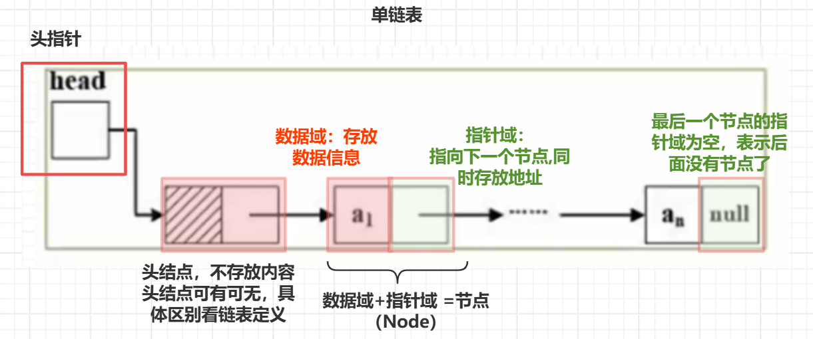

- **删除节点：**

  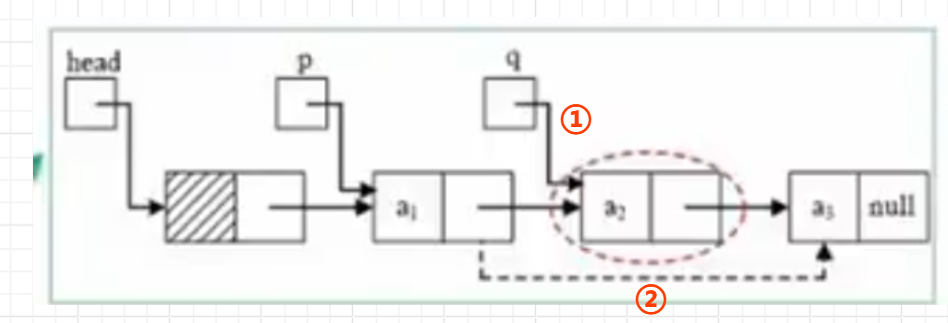

  1）如图，删除a~2~元素。首先用一个**指针q**指向a~2~ [^注19]，用p指针指向a~1~（被删除节点的前驱），用于定位a~2~的位置

  2）把a~1~的指针指向后一个元素 a~3~

  3）代码实现：

  ```c
  q = p->next; 	   // 1.让q指向a2，也就是p指向的后一个节点
  p->next = q->next; // 2.让a1直接指向a3
  free(q);           // 3.把a2的内存释放掉，避免内存泄漏
  ```

  - 注意：1,2步骤不能交换位置，否则会导致q指向的是a~3~，导致a~3~节点数据被删除，a~2~从链表中断开，但数据未清理的情况

  

- **插入节点：**

  

  1）如图，要在a~1~，a~2~中插入一个x节点。先用p指针定位a~1~的位置，用s指针指向x后，**把x节点的指针指向a2**

  2）再让a~1~的指针转向x节点

  3）代码实现：

  `````c
  s->next = p->next; 	// 1.让s(x节点）先指向a2节点
  p->next = s;		// 2.再把a1的指针指向x
  `````

  - 注意：1,2步骤不能调换。如果先让a~1~指向了x，会导致a~2~到最后一个节点的元素全部丢失，导致内存泄漏

  如果在无头的链表的第一个节点 a~1~前如何插入元素

  ```c
  s-next = head; // head是头指针，这里就是指s指向了head指向的节点，也就是a1
  head = s;	   // 让head指向s
  ```

  由此可以看出，**无头的链表在头部插入时，需要改变head的指向，而有头链表无论在哪里插入，head始终不变**

  


**2）循环链表**:

- 定义：相比于单链表，它的结尾处不会指向null，而是指向head，因此可以循环
- 优点：从任意一个节点出发，都可以回到head，寻找节点时相对方便

​                                          


**3）双向链表：**

- 定义：在数据域前又增加了一个指针，指向前一个节点
- 优点：在查找数据时可以回退，删除节点的速度更快
- 缺点：更加占内存（每个节点多了一个指针）


- 删除节点：

  

  1）如图，删除a~2~节点。先用p指针指向a~2~，再把a~1~的后驱指向a~3~，a~3~的前继指向a~1~即可

  2）代码实现：

  ```c
  p->prior->next = p->next;  // a1 的后继指向a3
  p->next->prior = p->prior; // a3 的前驱指向 a1
  free(p);				   // 释放a2的存储空间
  ```

  - 注意：这里和单链表不同，不需要q指针来定位，只需要一个指针，是因为：

    1）单链表中a~2~只有一个前驱a~1~可以指向它，需要一个q来确定a~2~的位置。

    2）但是双向链表中，a~2~自己就可以确定它的前驱后继，所以不需要多用一个指针来确定位置。

    **因此相比于单链表，双向链表的删除操作要更为简单**（省去了一个指针），**并且1，2两步可以前后调换位置**
  
  

- 插入节点：

  

  1）如图，在a1，a2中间插入x节点，**注意先新后旧**

  2）首先把x的前驱后继分别指向a~1~ 和 a~2~

  3）再把a2的前驱指向x，把a1的后继指向x

  4）代码实现：

  ```c				  
  q->prior = p; 		// 把x的前驱先找到a1
  q->next = p->next;  // x的后继找到a2
  p->next->qrior = q; // 把a2的前驱连到x
  p->next = q;	    // 把a1的后继连到x
  ```

  

## 2.4 栈和队列

### 2.4.1 栈(stack)

1. 定义：栈的本质就是线性表，**是只允许在一端进行插入或删除操作的线性表。**栈遵从一个原则：==后进先出==（LIFO）

2. 图示：

   

3. 案例：

**案例1：**栈的进出是有多种的，进栈 1，2, 3，**哪一种方法是不能用于出栈的**？

> ==规律：==
>
> **找逆序和中间**，即 如果一个数字x要先出栈，后面**比x小的数字**必须是**逆序（从大到小）**出栈

- 例如：3先出栈，则后面必须是 2,1，则是3,2,1，如果是 3,1,2则必定错误

> 题目详解：

1）第一种：先进后出：3,2,1

2）第二种：栈不一定要全部进完再出来，也可以进一个出一个，例如：2,3,1

1进

2进，2出

3进，3出

1出


3） 由第二种也可以得到：2,1,3 等等出栈顺序，此处不一一列举

1进

2进，2出

1出

3进，3出


4）**但是只有一种情况绝对不行，也就是：3,1,2**

​	如上面的图，如果3先出去了，说明1,2已经入栈了，此时的2还在1上面，因此1不可能在2前出栈


4.  栈的实现：栈可以用数组或链表实现

- 数组：例如用数组S来表示栈，则会给S加一个指针top（往往指向栈顶元素，实际根据题目而定,**以下用top指向栈顶做举例**）

  ​            在初始(空栈)时，`top = -1`

  - 入栈：

    1）先判断是否为满：`top == MAX_SIZE - 1`

    2）如果没有满，则 

    ````c
    S[++top] = x; // 先把指针上移，再放入数据。否则第一个数据会存到S[-1]导致越界
    ````

    3）如果满了还强行入栈，会导致**上溢（Overflow）**

    

  - 出栈：

    1）先判断是栈否为空：`top == -1`

    2）如果栈不是空值，则：

    ````c
    x = S[top--]; // 先放数据，再把指针往后移。否则下次数据会被覆盖
    ````
    
    3）如果栈为空还强行出栈，则会导致**下溢（Underflow）**

- 链表：用链表表示栈则更为简单，链栈中：头指针为栈顶，用于插入和删除，因为从头开始的效率是O(1)，效率极快。

  ​           若用链尾做栈顶则是O(n)，效率极低，不会这样使用

### 2.4.2 队列

1. 定义：队列是一种**先进先出(FIFO)的线性表**，它只允许在表的一端插入元素，而在表的另一端删除元素。

   ​	   在队列中，允许插入元素的一端称为队尾(Rear)，允许删除元素的一端称为队头(Front)


2. 案例题：


A：直接从左往右进入：得到 4,3,2,1，最后从左边出：4,3,2,1


B：按照顺序，1先进，由图可见1是第三个出，因此从左边进。2在1前面出，所以2也从左进入。3最后一个出，从右边进排最后。4第一个出，从左边进排第一。


C：同B选项，1排在第三，1从左进。2在最后，2从右进，排最后。3在1前面，3从左进。4在开头，4从左进。


D：后三位顺序是 2->3->1,其中1,2不可能分开，所以D为错误。可记结论：**后进大元素不可能夹在小元素中间**

#### 1.循环队列

1. 定义：把普通的顺序队列（数组）在逻辑上“首尾相连”，变成一个环。

   ​	    当指针走到数组末尾时，通过取模运算（`%`），让它直接回到数组开头，重复利用前面已经出队的空间

   - **head：**队头，指向下一次要读的元素，表示队列的开头，在入队时不会移动，出队时需要出队时先取出 `Q[head]`，再用`(head+1)%size`计算head位置
   - **tail：**队尾，指向下一次要写的位置，在循环队列中每次放入新数据，是先写入元素 `Q[tail]`，再移动向后移 `tail`，用`(tail+1)%size`计算tail的位置

2. 公式：

   注意：**循环列表一定要留一个空位**，**即`size=n`的列表**，**放的元素最多应该是`n-1`个**

$$
队列为空：head = tail
$$

$$
队列为满：(tail+1) \% size =head
$$

- 已知head ，size的情况下，如何快速求得队列满时的tail：

1）`head-1>0`时
$$
tail = head -1
$$
2）`head-1 < 0`时，其中`size-1`是实际最大容量，也就是留空后的容量
$$
tail = head - 1 + size
$$
3）二合一公式：
$$
tail = (head - 1 + size) \% size
$$

- head到tail的步长

$$
length = (tail - head + size) \% size
$$


3. 循环队列的公式和注意事项：

- ==循环列表留空：==

1）如图，这表示的是一个**空的循环队列**（即里面没有存放任何元素），它的`size=5`，下标是`0-4`,此时队头`head`和队尾`tail`都在一个格子 `0` 中[^注20]


2）现在把这个队列平铺是这样的：

| 指针     | head tail |      |      |      |      |
| -------- | :-------: | ---- | ---- | ---- | ---- |
| **下标** |     0     | 1    | 2    | 3    | 4    |
| **元素** |           |      |      |      |      |

3）循环队列依旧符合队列的基础定义：**即先进先出，头出尾进**，所以假设我们要放入第一个元素A，应当是从tail处放入的，也就会变成这样：[^注21]

| 指针     | head （头不变） | tail（尾朝后移一位） |      |      |      |
| -------- | :-------------: | :------------------: | ---- | ---- | ---- |
| **下标** |        0        |          1           | 2    | 3    | 4    |
| **元素** |        A        |                      |      |      |      |

4）此时我们再放入三个元素：B，C，D，就会变成这样

| 指针     | head |      |      |      | tail |
| -------- | :--: | :--: | :--: | :--: | :--: |
| **下标** |  0   |  1   |  2   |  3   |  4   |
| **元素** |  A   |  B   |  C   |  D   |      |

5）现在这个循环队列中有个四个元素，但size其实是5，如果放入第五个元素E就会出现这样的情况：

| 指针     | head  tail |      |      |      |      |
| -------- | :--------: | :--: | :--: | :--: | :--: |
| **下标** |     0      |  1   |  2   |  3   |  4   |
| **元素** |     A      |  B   |  C   |  D   |  E   |

可以发现：**如果这里是普通队列，就会因为tail越界而报错**（因为后面没有格子了）

但这是个循环队列，此时队列已满，所以tail会回到开头(类似图一那个圆圈），和head重合，如上面的表格所示，此时：**head=tail**

由循环队列的公式可以得知，当`head=tail`时应该判断为空，**但实际上这个循环队列已经满了**，所以说此时会发生冲突。

因此**在循环队列中一定要留空**


- **如何给循环队列留空**

为了避免上述情况的发生，则需要用这个公式：`(tail+1) \% size == head`，当这个判断成立时，即表示队列已满，不能再往里面放入元素了，拿上述案例举例，当tail=4，head=0时：
$$
(4+1)\% 5 = 0
$$
可以得到：`0 == 0`的，因此可以看出，当tail= 4时，队列已满，再放入元素就会导致冲突了。


4. 循环队列的案例

| 指针     |      |      |      | head | tail |      |
| -------- | :--: | :--: | :--: | :--: | :--: | :--: |
| **下标** |  0   |  1   |  2   |  3   |  4   |  5   |
| **元素** |      |      |      |  A   |      |      |

问：根据这个循环队列，得到其最大容量，以及当tail为多少时，队列为满

解：

1）最大容量：size-1 = 6-1= 5

2）根据公式可以得到：

（tail+1）%6 = 3

把（tail+1）看做一个整体，可以得到：3%6=3，或是9%6=3，等等解答，由于 0≤ tail<6，因此队列满时tail=2

也可以用速算公式直接得到：tail = head - 1 = 3 -1 =2


## 2.5 串

1. 定义：串是仅由字符构成的有限序列，是**取值范围受限的线性表**。即串是个只能装字符（**字母、数字、标点符号**）的数组

   一般记为：

$$
S='a1a2....an'
$$


- 其中S是串名
- a~1~a~2~，a~n~是串值。


2. **空串：** **长度为零的串**，空串**不包含任何字符**

- 代码表示：`""`，注意：里面什么也没有，包括空格
- 长度：`Length = 0`


3. **空格串：** 由一个或多个空格组成的串，区分空串：空格串里是包含字符的

- 代码表示：`" "`
- 长度：串中空格的数量


4. **子串**：由串中任意长度的**连续字符构**成的序列。含有子串的串称为主串。

​		子串在主串中的位置指子串首次出现时，该子串的第一个字符在主串中的位置。**空串是任意串的子串**。

​		任何串都有一个子串（包括空串），就是它本身

- 案例：主串：`"abcdefg"`，它的子串可以是：`"ab"`，`"def"`，`"fg"`等等，但是不可以是：`"afg"`因为**子串必须是连续的**


5. **串相等：**指两个串长度相等且对应位置上的字符也相同。

6. **串比较：**两个串比较大小时以字符的ASCIl码值作为依据。比较操作从两个串的<u>第一个字符</u>开始进行，字符的ASCI码值大者所在的串为大;若其中一一个串先结束，则以串长较大者为大。


7. 对串的基本操作：

   (1) 赋值操作：`StrAssign(s,t)` 将串t的值赋 （复制）给串s。
   (2) 连接操作：`Concat(s,t)` 将串t接续在串s的尾部，形成一个新串。(类似python中的：`s+t`)
   (3) 求串长：`StrLength(s)` 返回串s的长度。
   (4) 串比较：`StrCompare(s,t)`比较两个串的大小。
   (5)求子串：`SubString(sub, s, start, len)` 返回串s中从start开始的、长度为len的字符序列（子串）。

8. 串的存储结构
   (1)串的顺序存储**（定长）**: 定长存储结构，即**用一个固定大小的数组装字符串**，如果串长超过了容量，就会导致截断（丢失数据）
   (2)串的链式存储: 块链，即用链表存储串，一般是一个节点放入一个数组+指针


9. 子串的定位操作通常称为串的模式匹配，它是各种串处理系统中最重要的运算之一。子串也称为模式串。


## 2.6数组

1. 定义：数组是一个由**相同数据类型**的元素构成的**有限**集合。数组在内存里，就是一块 **连续，且首尾相连 **的物理内存空间
   - 特点：**相同类型元素、连续存储、支持随机访问**
   - 同构性：里面只能装相同的类型的元素，例如放`int`的数组就不能出现其他类型（如`char`)，因为只有同类型的元素才能保证大小统一，物理内存才能整齐的切块
   - 有限性：长度固定，不可无限长
2. 数组按下标访问元素的时间复杂度通常为：\[ O(1) \]
3. 分类

| 数组类型           | 定义                                                   | 存储地址计算                                                 |
| ------------------ | ------------------------------------------------------ | ------------------------------------------------------------ |
| 一维数组 ：a[n]    | 排成一条直线的元素，逻辑结构为线性                     | a[i] 的存储地址为：a+i*len                                   |
| 多维数组：a[m] [n] | 二维及以上的数组都不再是线性表结构，而是**网格或表格** | a[i] [j] **(按行存储)**为:a+(i* n+j) * len                                                                      a[i] [j] **(按列存储)**为:a+(j* m+i)*len |

4. 数组的公式本质就是：


​	注意：以上公式所适用的条件是：数组的下标是从零开始的。实际需要根据题目减去初始下标的偏移量

- 案例：假设有个数组：`a[1...3][1...4]`，优先按行排列，每个元素占4字节，首元素地址=2000，那么求`a[3][2]`的地址

  1）此处可以看到，数组不是从0开始的，是从1开始的，因此`i`和`j`的值都要`-1`，因此公式变为
  $$
  a+[(j-1)* m+(i-1)]*len
  $$
  2）带入计算得到：`Addr(a[1...3][1...4])`= 2036

  3）因此可以得到通用公式：数组a[L~1~...m] [L~2~...n]的元素地址计算公式为

  - 按列存储：

  $$
  Addr(a[i][j])=  [(j-L_2)*m+(i-L_1)]*len +a
  $$

  - 按行存储：

  $$
  Addr(a[i][j])=  [(i-L_1)*n+(j-L_2)]*len +a
  $$

  

### 2.6.1 一维数组

1. 定义：排成一条直线的元素，逻辑结构为线性

2. 基础表达

```c
[type] a[n]
```

2. 公式理解：例如，`int a[5]` 是一个存放了五个整数的一维数组，它的内部展开可以是这样：`int a[5] = [10,20,30,40,50] `

​	在内存中应该这样表示：假设每个元素占4字节，数组的首地址是1000

| 下标     | a[0] | a[1] | a[2] | a[3] | a[4] |
| -------- | ---- | ---- | ---- | ---- | ---- |
| **元素** | 10   | 20   | 30   | 40   | 50   |
| 存储地址 | 1000 | 1004 | 1008 | 1012 | 1016 |

可以看到从首地址1000开始，后面每个元素地址都是依次增加4，这是因为 **每个元素所占的字节大小=4**，<u>因此每过一个元素，就要跳过它所占的字节大小</u>

- 假设现在想要找到 `a[3]`的地址，那么就要跳过前面前面的元素，也就是：`a[3]`前面的元素个数 * 每个元素的大小 + 首地址

  得到 `address(a[3])` = 3 *4  + 1000

因此就可以得到公式：
$$
Addr(a[i]) = i*len + a
$$

- i ：所要找的元素下标（编号）
- len ：每个元素所占的字节[^注22]
- a：首地址


### 2.6.2 二维数组

1. 定义：二维数组具有两个下标维度，可以在逻辑上看成表格，但其元素仍然可以按照一定顺序存放在连续的存储空间中。

   ​	但是在内存中，无法按照正常的表格排列，必须是一条连续的空间，所以二维数组有 **按列排序 和 按行排序** 两种排列方法

2. 基础表达：**前行后列**

```c
a[m][n]
```

- m : 数组的行数
- n ：数组的列数

`a[m][n]`的某一元素表示为：

```c
a[i][j]
```


3. 理解案例：（注意，此图只为帮助理解，实际的二维数组构成要根据后面的按行，按列排序为准）

假设二维数组：`a[3] [4] `，也就是 3行 4列，可以用下图来表示：

(下图也是按行排序的图示)

| a[0] [0] | a[0] [1] | a[0] [2] | a[0] [3] |
| -------- | -------- | -------- | -------- |
| a[1] [0] | a[1] [1] | a[1] [2] | a[1] [3] |
| a[2] [0] | a[2] [1] | a[2] [2] | a[2] [3] |

但是在内存中，为了存储成一条连续的空间，就拆分成了两种存储方式

- 按列排序：优先按照列来排序，存完一列，再存第二列
- 按行排序：优先按照行来排序，存完一整行，再存第二行

以下将分开记录两种排序方法的区别：


#### 1. 按列排序

`a[3][4]`的按列排序，可以看到顺序和按行排序完全不同，假设每个元素所占字节=4，首元素地址=1000

（**速记**：行不变，列改变）

| a[0] [0] | a[1] [0]     | a[2] [0] |
| -------- | ------------ | -------- |
| a[0] [1] | a[1] [1]     | a[2] [1] |
| a[0] [2] | ==a[1] [2]== | a[2] [2] |
| a[0] [3] | a[1] [3]     | a[2] [3] |

假设我们需要找到 图中高亮的`a[1][2]`的地址，需要以下几步：

1）首先从表格中可以得知，`a[1][2]`前有两行，而一行中有3列（也就是3个元素），那么首先要跳过3个元素
$$
j * m = 2 * 3 =6
$$
2）`a[1][2]`的前面有一个元素，所以再跳过一个 ：6+1 = 7
$$
j * m +i = 6 +1 =7
$$


3）得到`a[1][2]`前面总共的元素个数之后，再乘以每个元素的大小，加上首元素，就可以得到`a[1][2]`的内存地址了
$$
Addr(a[1][2])= (j*m+i)*len +a = 7*4 +1000 = 1028
$$
 最终可以得到公式：
$$
Addr(a[i][j])=  (j*m+i)*len +a
$$


- `m`：数组的总行数。
- `n`：数组的总列数。

- `i`：该元素的行号(行下标)
- `j`：该元素的列号(列下标)
- `len`：每个元素的字节大小
- `a`：首地址


#### 2. 按行排序

还是用 `a[3] [4] `举例，可以看到，它的图形表达和正常的表格完全一致，假设每个元素所占字节=4，首元素地址=1000

（**速记**：列不变，行改变）

| a[0] [0] | a[0] [1] | a[0] [2]     | a[0] [3] |
| -------- | -------- | ------------ | -------- |
| a[1] [0] | a[1] [1] | ==a[1] [2]== | a[1] [3] |
| a[2] [0] | a[2] [1] | a[2] [2]     | a[2] [3] |

假设我们需要找到 图中高亮的`a[1][2]`的地址，需要以下几步：

1）首先从表格中可以得知，`a[1][2]`前有一行，而一行中有4列（也就是4个元素），那么首先要跳过4个元素
$$
i * n = 1 * 4 =4
$$
2）`a[1][2]`的前面有两个元素，所以再跳过两个 ：4+2 =10
$$
i * n+j = 4 +2 =6
$$


3）得到`a[1][2]`前面总共的元素个数之后，再乘以每个元素的大小，加上首元素，就可以得到`a[1][2]`的内存地址了
$$
Addr(a[1][2])= (i*n+j)*len +a = 6*4 +1000 = 1024
$$
 最终可以得到公式：
$$
Addr(a[i][j])= (i*n+j)*len +a
$$


- i：该元素的行号
- j：该元素的列号
- len：每个元素的字节大小
- a：首地址

**可以看到，两个公式除了后半部分，括号里的内容是对调的**


### 2.6.3 三角矩阵

1. 定义：三角矩阵是一种特殊矩阵，以主对角线为界，其中**一侧三角区域的元素全部为 0**。由于这些元素的值已知，因此可以省略对它们的单独存储，仅保存主对角线和另一侧三角区域的元素，从而节省存储空间

2. 压缩存储：压缩存储是为了节约更多空间。例如有一个二维数组 `A[4][4]`，如果直接存放则需要：`4*4=16` 格空间。但如果把它按三角形排布，可以得到下图的格式: 

   | A[0] [0]     |              |              |              |
   | ------------ | ------------ | ------------ | ------------ |
   | **A[1] [0]** | **A[1] [1]** |              |              |
   | **A[2] [0]** | **A[2] [1]** | **A[2] [2]** |              |
   | **A[3] [0]** | **A[3] [1]** | **A[3] [2]** | **A[3] [3]** |

   没有填入数组的地方都是0[^注23]，因此通过这种方式，只需要存储 ：`4+3+2+1=10` 格的空间，相比原先节约了6个元素的空间

   将得到的三角矩阵再放入一个一维数组，就完成了压缩：

   > 下图是起始为0的一维数组M[0..9] [^注25]

   | A[0] [0] | A[1] [0] | A[1] [1] | A[2] [0] | A[2] [1] |
   | -------- | -------- | -------- | -------- | -------- |
   | A[2] [2] | A[3] [0] | A[3] [1] | A[3] [2] | A[3] [3] |

​	在下三角矩阵里求：`A[1][3]`的位置的时候，系统判定此时`i<j`，因此会返回0，不需要花时间去找，这就是利用矩阵的**结构特征**节	省存储空间

3. 图示：

   注意：当`i=j`时，元素在主对角线上


4. 公式：

> 以下公式的成立条件都是按行优先存储

1）**上三角矩阵公式：**

- 当M从M[0]开始：
  - `k` 是压缩后数组 M 中的下标。

$$
k= \frac {i[n+(n-i+1)]}2+(j-i)
$$

$$
A[i][j] = M[k]
$$


- 当M从M[L~1~]开始：

$$
k = \frac {i[n+(n-i+1)]}2+(j-i)+L_1
$$


2）**下三角矩阵公式：**

- 当M从M[0]开始：
  $$
  A[i][j] = M[ \frac{i*(i+1)} 2 + j ]
  $$

- 当M从M[L~1~]开始：

$$
A[i][j] = M[ \frac{i*(i+1)} 2 + j+L_1 ]
$$


> 按列优先存储公式如下，此处没有加M的初始值，这个规则同按行优先存储：

1）**下三角矩阵公式：**
$$
A[i][j] = M[\frac{j(2n-j+1)}2+(i-j)]
$$
2）**上三角矩阵公式：**
$$
A[i][j] = M[\frac{j(j+1)}2+i]
$$


3）上下三角矩阵可以保存的元素个数：

> 包括主对角线时

$$
\frac {n(n+1)}2
$$


#### 1. 下三角矩阵：

1. 图示：

> i ≥ j ，`A[4][4]`的三角矩阵

| 行下标 | 元素         |              |              |              | 保留元素个数 |
| ------ | ------------ | ------------ | ------------ | ------------ | ------------ |
| 0      | **A[0] [0]** |              |              |              | 1            |
| 1      | **A[1] [0]** | **A[1] [1]** |              |              | 2            |
| 2      | **A[2] [0]** | **A[2] [1]** | **A[2] [2]** |              | 3            |
| 3      | **A[3] [0]** | **A[3] [1]** | **A[3] [2]** | **A[3] [3]** | 4            |

2. 公式推导：

可以根据图示得到，第0行存储1个元素，第1行存储2个元素.......第`i`行的元素个数是：`i+1`

因此，假设要找元素`A[3][2]`在矩阵中的位置（在M中的位置），则需要：
1）判断`A[3][2]`前面有几行：有3行:`0,1,2`，这些行分别保留了：`1+2+3 = 6`个元素。观察可以发现，这些行保存元素的个数是`公差=1`的**等差数列**，通过等差数列的求和公式可以得到，当前面有`i`行时，保留的元素个数是：
$$
1+2+3+....i =  \frac{i*(i+1)} 2
$$
2）同二维数组的计算公式一样，在算完前面的行之后，还要计算`A[3][2]`在本行前面的元素个数，因为这里是按行优先排列，可以得知`前面的元素个数=j`,把这个加在上述公式上，就是**`A[i][j]`前面所有的元素个数公式**：
$$
A[i][j]前全部元素个数 =  \frac{i*(i+1)} 2 + j
$$
3）最终得到的这个值，也就是`A[3][2]`在`M[9]`中的位置，但是注意：如果M是从`M[1]`开始的，**则要再公式最后加上偏移值`1`**

​      如果数组A不是从[0]开始的，可以参考：[2.6数组](#2.6数组)中第四部分<u>数组的公式本质</u>部分

- 当M从M[0]开始：
  $$
  A[i][j] = M[ \frac{i*(i+1)} 2 + j ]
  $$

- 当M从M[L~1~]开始：

$$
A[i][j] = M[ \frac{i*(i+1)} 2 + j+L_1 ]
$$

3. 案例：


1）从题目提取信息：三角矩阵`A[9][9]`是从0开始的，数组`M[1...m]`是从1开始的。题目要求按照"行下标不小于列下标"压缩，

​	即`i ≥ j`,用下三角矩阵计算

2）把i，和j带入正三角矩阵公式：注意，这里因为M是从1开始的，所以要加上偏移量1。得到结果A
$$
A[i][j] = M[\frac {i*(i+1)}2+j+1]
$$
==**代入法**==：如果考试的时候忘记公式也可以使用该方法，或是用于检验：

- 首先可以知道，所有三角矩阵一定会有元素：`A[0][0]`,而该元素在数组M中一定放在开头，也就是该题的M[1]的位置，可以把

  `i=0，j=0,M=1`带入选项，看哪个选项能算出来`M=1`

- 带入计算后得到，A，D选项都可以得到M=0，这时候可以再取个稍微特别的元素，例如`A[1][0]`,该元素一定在`M[2]`的位置，带入A，D选项分别验算。最终得到只有A选项能够算出来`M=2`，因此此题选A


#### 2. 上三角矩阵公式：

1. 图示

> i ≤ j ，`A[4][4]`的三角矩阵

| 行下标 | 元素         |              |              |              | 保留元素个数 |
| ------ | ------------ | ------------ | ------------ | ------------ | ------------ |
| 0      | **A[0] [0]** | **A[0] [1]** | **A[0] [2]** | **A[0] [3]** | 4            |
| 1      |              | **A[1] [1]** | **A[1] [2]** | **A[1] [3]** | 3            |
| 2      |              |              | **A[2] [2]** | **A[2] [3]** | 2            |
| 3      |              |              |              | **A[3] [3]** | 1            |

2. 公式推导：

1）首先观察可得，如果一共有n行，第i行个元素个数是：
$$
i_{行元素个数}=n -i
$$
2）要求 `A[1][2]`在矩阵中的位置，还是要先知道前面有多少个元素。`A[1][2]`前面有1行，存储了4个元素。而`A[1][2]`在本行前面有1个元素，加起来可以得到，`A[1][2]`前面有5个元素。有此得到公式：[^注24]
$$
前i行总元素数 = n + (n-1)+(n-2)+ ....(n-i+1)
$$
利用等差数列的求和公式得到：
$$
前i行总元素数 = \frac {i[n+(n-i+1)]}2
$$
3）再把`A[i][j]`在本行前的元素加上，注意，上三角矩阵中第`i行`不是从`0列`开始的，是从 `i`列开始的，所以`A[i][j] `在第`i`行前面的元素个数是：
$$
A[i][j]在本行前的元素个数 =j-i
$$


例如`A[1][2]`前面的元素个数就是：`2-1=1`个，而第1行的起始列是：1。如果是`A[2][2]`，它在第2行的起始列就是2

4）因此总距离就是：

- 当M从M[0]开始：
  - `k` 是压缩后数组 M 中的下标。

$$
k= \frac {i[n+(n-i+1)]}2+(j-i)
$$

$$
A[i][j] = M[k]
$$


- 当M从M[L~1~]开始：

$$
k = \frac {i[n+(n-i+1)]}2+(j-i)+L_1
$$


[^注1]: 操作数是运算符处理的数据
[^注2]: *SI, DI, BX, BP 是8086汇编里的专用寄存器*
[^注3]: I/O系统是计算机或工业控制系统中，负责输入输出操作的软硬件组合，用于实现数据在设备与主机之间的传输和控制。

[^注4]: RAM又叫随机存储器，可随时读写，速度非常快，但断电后数据丢失，而其他存储设备如：SSD，HDD等是可以断电后保留的
[^注5]: CPU 是**不可能**直接去访问硬盘的，外设也不行，必须先把硬盘数据调入内存，CPU才能用。这就是 I/O 的概念
[^注6]: 因为**CPU无法直接访问辅存**，外设，所以才需要I/O的概念。
[^注7]: RAM是内存的一种，是可以读写的，ROM也是内存，是只读的
[^注8]: 在计算机中，块号都是用二进制表示的，因此Tag就是主存块号除去另外两部分，剩下的高位
[^注9]: 注意：Cache地址结构，和主存地址的表达式指的是同一个东西，但是主存地址中的 Tag（主存高位），Index（主存中间位）和Offset都是切分的“主存的物理地址”  ，和Cache里存放的Tag无关。 只有在检验步骤，会检验两个Tag是否相同，来判断数据位置是否准确
[^注10]: 全相映像的遍历并非一个个去查看，而是同时进行多个比较，因此就需要“比较器”，Cache有多少块（行），硬件就需要多少个比较器
[^注11]: 不使用Cache ，CPU访问存储器的速度 。同理，t~a~ 就是使用Cache，CPU访问存储器的时间
[^注12]: 如果这里不能理解，也可以理解为：地址线的数量 = n = 2^n^ 。 通过原理来理解，即是三根线（三位二进制数），就可以表示8种不同的组合 
[^注13]: **从A到B，求有多少数**，算出 B -A 的结果一定要加一。例如：0-9 之间有几个数，是 9-0+1 =10个数，+1里的1也就是初始数A
[^注14]: 虚拟存储器是一个存储**系统**，不存在硬件。相比于由硬件自动完成的Cache，虚拟存储器必须要有操作系统参与
[^注15]: 如打印文件等操作，就无需输入
[^注16]: 就是在不新建大量额外空间(就是固定空间，无论数据多大，都不改变的那种)的基础上对原数据进行操作。
[^注17]: 相同的数据类型是指：例如一个线性表中放的是整形，那就不能再放浮点型，以此类推
[^注18]: 里面的数据必须是有限个，且是序列：有先后顺序
[^注19]: 这里q存储的不是a~2~的数据，而是a~2~的内存地址，用于告知系统被删除的节点a~2~的位置，以便删除a~2~的数据（释放内存），以避免内存泄漏
[^注20]: 实际不一定会在0开始，队头可能在任意一个格子中，需要根据题目判断
[^注21]: tail是如何移动的：`(tail+1) \% size`这个公式计算得到的结果就是tail移动的位置（要在size内）
[^注22]: 这里可以体现出定义中 **同构性**的重要性。因为元素类型相同，所以每个元素所占的字节大小相同，此处才能用这个公式便捷计算
[^注23]: 这里并不是人为定义的，而是那个位置确实是0，三角矩阵本身就长这样。与之相比的另一种对立矩阵就更加特别，它的0值的位置是分散的，因此它的压缩就更为复杂
[^注24]: 为什么最后一项是：（n-i+1），因为这个公式求的其实是第i行前所有行的元素数量，也就是实际应该是（i-1），带入就是n-（i-1），展开得到 (n-i+1)
[^注25]: 注意这里不能用M[9]表示M有十个元素，因为在C语言编译中会默认M[9]是9个元素，这里要么写M[10]，要么写M[0...9]
